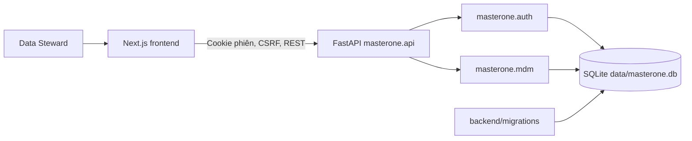

# Kiến trúc MasterOne hiện tại

MasterOne là ứng dụng hai phần: Next.js trong `frontend/` và FastAPI trong package cài được `backend/src/masterone/`. Mỗi tài khoản sở hữu các lần import của mình. Backend xử lý CSV CRM/ERP, gợi ý các cặp hồ sơ bằng tín hiệu khớp chính xác và lưu quyết định cùng bản nháp Golden Record trong SQLite.

## Ranh giới mã nguồn

| Thư mục | Trách nhiệm |
| --- | --- |
| `backend/src/masterone/api/` | HTTP routes, validation và response |
| `backend/src/masterone/auth/` | User/session ORM, mật khẩu, Origin, CSRF và giới hạn đăng nhập sai |
| `backend/src/masterone/db/` | `Base`, UTC clock, engine và session dependency |
| `backend/src/masterone/mdm/` | Import CSV, matcher, sở hữu import, candidate và Golden Record |
| `backend/migrations/` | Alembic revision `0001`–`0004`; không tự tạo schema khi app khởi động |
| `backend/tests/` | Test API, auth, ownership, migration và agent mẫu |
| `frontend/` | UI, trạng thái phiên phía client và API client |

`agents/`, `models/` và `services/` hiện chứa luồng AI mẫu của template; sản phẩm MDM chưa phụ thuộc vào luồng đó. Việc di chuyển thư mục trong đợt này không thay đổi endpoint hay thuật toán matching.

## Dữ liệu và vận hành

Chạy backend từ thư mục gốc repo. `masterone.config` đọc `.env` ở root, và SQLite mặc định tại `data/masterone.db`. `backend/alembic.ini` cùng `backend/migrations/` được tìm tương đối từ root; chạy `python -m masterone.mdm.migrate` trước khi khởi động app. CI cài package qua root `requirements.txt`, một shim trỏ tới `backend/pyproject.toml`; Docker cài package không editable.

Phiên đăng nhập được lưu server-side, cookie `HttpOnly`; mutation yêu cầu Origin hợp lệ và CSRF token. Import/candidate được kiểm tra chủ sở hữu trên từng API. Import cũ chưa có chủ sở hữu được giữ trong SQLite và chỉ chuyển bằng CLI offline sau khi xác minh.
