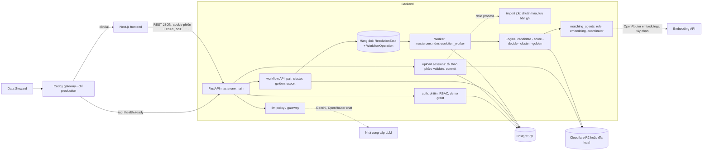
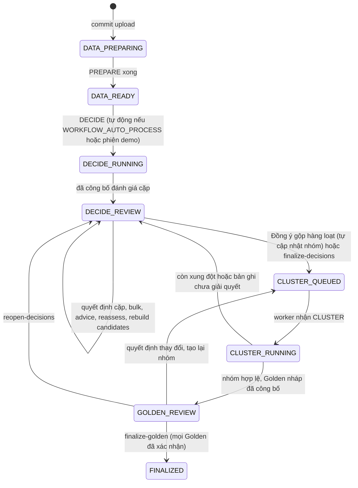

# Kiến trúc MasterOne

Tài liệu mô tả hệ thống **đang chạy** trong repo. Thuật toán matching chi tiết: [docs/MATCHING_ENGINE.md](docs/MATCHING_ENGINE.md). Endpoint: [docs/API.md](docs/API.md).

## 1. Thành phần

| Thành phần | Vị trí | Vai trò |
|---|---|---|
| Frontend | `frontend/` (Next.js App Router, React 19, TanStack Query) | Giao diện bốn bước theo phiên, MasterBot hướng dẫn, chế độ demo |
| API | `backend/src/masterone/main.py`, `api/` | Xác thực, kiểm tra quyền sở hữu run, nhận lệnh, đọc kết quả; **không** chạy pipeline nặng |
| Worker | `mdm/resolution_worker.py` | Nhận `ResolutionTask`, thực thi operation (PREPARE, DECIDE, CLUSTER...) với lease, heartbeat và attempt fence |
| Import job | `mdm/import_jobs.py` | Validate/commit upload trong tiến trình con (tránh chặn API); `IMPORT_JOBS_INLINE=true` chạy trong request, chỉ để test |
| Database | PostgreSQL 16 (Neon hoặc local); SQLite cho test | Nguồn sự thật duy nhất: người dùng, bản ghi, cặp, nhóm, Golden, audit, hàng đợi |
| Object storage | Cloudflare R2 (`storage/r2.py`) hoặc `UPLOAD_STAGING_DIR`, `WORKFLOW_ARTIFACT_DIR` | File upload theo phần, artifact bất biến của pipeline (Parquet/JSON có checksum), CSV xuất |
| Gateway LLM | `llm/policy.py`, `llm/gateway.py`, `llm/streaming.py` | Cổng duy nhất cho mọi lời gọi LLM: kiểm tra phê duyệt provider/model, retention, giá, ngân sách, cooldown; Gemini chính, OpenRouter chỉ dự phòng khi Gemini hết quota |
| Gateway web | `deploy/Caddyfile` | TLS tự động, định tuyến `/api/*`, `/health`, `/ready` về backend; còn lại về frontend |

Mã mẫu `agents/`, `models/`, `services/`, `api/routes.py` (`/chat`, `/status`, LangGraph) là phần còn lại của template, chỉ bật khi `SAMPLE_CHAT_ENABLED=true`; sản phẩm MDM không phụ thuộc vào chúng. `api/large_imports.py` và `pipeline/` (ghép CSV trên R2) **không được mount** trong `main.py` và frontend không còn gọi; đây là mã tồn dư, luồng upload hiện hành là upload sessions.

## 2. Cấu trúc mã nguồn

| Thư mục | Trách nhiệm |
|---|---|
| `backend/src/masterone/api/` | Router: `auth`, `mdm_uploads`, `mdm_runs`, `mdm_workflow` (luồng chính), `mdm_resolution` (legacy v1 + xuất/history), `mdm_demo`, `mdm_matching_foundation` |
| `backend/src/masterone/auth/` | ORM user/session/demo grant, Argon2id, Origin + CSRF, rate limit đăng nhập, RBAC (`security.py`), CLI `manage_role` |
| `backend/src/masterone/db/` | Base, đồng hồ UTC, engine/session |
| `backend/src/masterone/llm/` | Policy, gateway, streaming SSE, hợp đồng tư vấn cặp, giải thích |
| `backend/src/masterone/mdm/` | Toàn bộ nghiệp vụ: import, workflow, engine (xem dưới) |
| `backend/src/masterone/mdm/pipeline/` | Chuẩn hóa, blocking/candidate, scoring, policy, ràng buộc cứng, clustering, survivorship |
| `backend/src/masterone/mdm/matching_agents/` | Rule agent, embedding agent, coordinator, retrieval, ngân sách thực thi |
| `backend/src/masterone/mdm/config/` | Policy `policy_person_v3.yaml`, cấu hình cluster `clustering_person_v2.yaml` |
| `backend/src/masterone/storage/` | R2, repository, checkpoint, manifest, Parquet, demo scope |
| `backend/migrations/` | Alembic `0001`–`0039`; app không tự tạo schema |
| `backend/tests/` | Pytest theo miền: `test_mdm`, `test_api`, `test_llm`, `test_agents`, `test_pg` |
| `frontend/app/` | Route: `/`, `/login`, `/register`, `/app`, `/app/uploads/[id]`, `/app/sessions/[runId]/{data,decisions,clusters,golden,utilities}`, `/app/demo`, `/app/legacy` |
| `frontend/src/components`, `lib/` | Component theo màn hình; `lib/api.ts` và `workflowApi.ts` là lớp gọi API, `permissions.ts` kiểm tra capability |
| `deploy/`, `docker-compose*.yml`, `Dockerfile` | Đóng gói và triển khai |
| `scripts/`, `benchmark/`, `eval/` | Kiểm chứng, benchmark, đánh giá offline (xem [DEVELOPMENT](docs/DEVELOPMENT.md)) |

Các module `mdm/workflow_*.py` là lớp điều phối luồng phiên (operation, revision fence, đọc/ghi trang); `mdm/resolution_*.py` là lớp import, legacy v1, xuất và lịch sử; `mdm/pipeline/` là engine thuần tính toán.

## 3. Máy trạng thái của một phiên

`ResolutionRun.workflow_state` (chỉ với `workflow_version = 2`):

Tab Nhóm và Hồ sơ đại diện mở được ngay khi đã có ít nhất một phiên bản nhóm (`cluster_revision > 0`), kể cả lúc phiên còn ở `DECIDE_REVIEW`; khi còn xung đột nhóm chỉ ở dạng **dự kiến** (đọc và lưu nháp, không xác nhận/xuất).

Mỗi lệnh ghi là một **WorkflowOperation** (`QUEUED → RUNNING → COMPLETED | DEGRADED | FAILED`, có `RETRYABLE_FAILED`), idempotent theo `request_id` và bị chặn bởi `expected_workflow_revision` (cộng thêm revision quyết định, nhóm, Golden tùy lệnh). Gửi lại cùng `request_id` với payload khác trả `409 REQUEST_ID_PAYLOAD_MISMATCH`; lệch revision trả `409` để UI tải lại thay vì ghi đè. Bảng chuyển tiếp hợp lệ nằm ở `mdm/workflow_contracts.py:TRANSITIONS`.

Loại operation: `PREPARE`, `DECIDE`, `PAIR_ADVICE`, `ASSESS_PAIRS` (reassess), `PAIR_DECISION`, `AMEND_PAIR`, `BULK_DECISIONS`, `CLUSTER_PREVIEW`, `CLUSTER`, `GROUP_APPROVAL`, `BULK_GROUP_APPROVAL`, `GROUP_ANNOTATIONS`, `GOLDEN_RESOLVE`, `CONFIRM_SELECTED`, `FINALIZE_GOLDEN`, `REOPEN_DECISIONS`, `REBUILD_CANDIDATES`, `STRUCTURE_PREVIEW`, `AUTOMATION_SHADOW|APPLY|STOP`, `RETRY_OPERATION`.

## 4. Luồng dữ liệu

1. **Upload** (`/mdm/upload-sessions`): trình duyệt gửi từng phần 8 MiB (tối đa 16 MiB) tới API hoặc presigned URL R2; có thể thay/thêm file, tiếp tục sau khi mất kết nối. `validate` kiểm tra header theo hợp đồng `p119_input_v1`, ID trùng, nguồn hợp lệ trong tiến trình con có giới hạn bộ nhớ; `commit` tạo `ResolutionRun` + `ResolutionRecord` với `raw_fields`, `normalized_fields`, `quality_flags`, `lineage`.
2. **PREPARE**: chuẩn hóa (Unicode, điện thoại, email, ngày sinh, địa chỉ, giấy tờ), gắn chất lượng từng trường (`VALID`, `PLACEHOLDER`, `SHARED`...), công bố số liệu tổng quan cho tab Hồ sơ.
3. **DECIDE**: sinh ứng viên (blocking exact + composite + TF-IDF, tùy chọn pass PERSON recovery), chấm rule và áp policy `person-v3`; nếu bật embedding thì embedding agent thêm bằng chứng cosine (chỉ bổ sung, không đổi quyền gộp); coordinator R1 hợp nhất và `taxonomy` phân loại cặp. Kết quả là artifact đánh giá bất biến + hàng `WorkflowPair`.
4. **Duyệt cặp**: người dùng ghi quyết định `merge | no_merge | deny | defer` (mỗi cặp có `revision`); `deny` tạo ràng buộc cannot-link vĩnh viễn. Các cặp đã chấp nhận (`ACCEPTED`) vào **hàng đợi chờ tạo nhóm**; một cặp chỉ rời hàng đợi khi hai đầu của nó cùng nằm trong một nhóm đã công bố. Mỗi lần duyệt hàng loạt "Đồng ý gộp" có cặp được áp dụng, backend tự xếp hàng một `CLUSTER` làm mới nhóm (gộp nhiều lần duyệt thành lần chạy theo `decision_revision` mới nhất). Người dùng cũng có thể gọi `finalize-decisions` (hàng đợi `pending`/`all`, `allow_partial`, hoặc kèm xem trước `cluster-preview`).
5. **CLUSTER**: dựng nhóm từ các liên kết đã chấp nhận, kiểm tra ràng buộc cứng giữa mọi cặp thành viên, giới hạn kích thước 20, phát hiện xung đột; mỗi liên kết Accept là xác nhận thủ công của người duyệt. Công bố phiên bản nhóm (`WorkflowGeneration`) cùng Golden nháp; có thể ở dạng một phần (`PARTIAL`) khi còn xung đột.
6. **Golden**: survivorship theo xác minh, chất lượng, độ ưu tiên nguồn, thời điểm cập nhật nguồn; người dùng chọn/sửa từng trường, xác nhận, rồi `finalize-golden`.
7. **Xuất**: CSV Golden đã chọn (`/golden/export`), CSV nguồn tái dựng và các snapshot trong Lịch sử; xuất stream có ngân sách đĩa/RSS/thời gian.

## 5. Mô hình dữ liệu (nhóm bảng)

| Nhóm | Bảng chính |
|---|---|
| Xác thực | `users` (role mặc định `VIEWER`), `auth_sessions` (hash SHA-256 của token), `auth_login_attempts`, `demo_grants` |
| Upload | `mdm_resolution_upload_sessions`, `_upload_files`, `_upload_parts` |
| Run và bản ghi | `mdm_resolution_runs`, `_files`, `_records`, `_tasks`, `_job_attempts`, `_run_summaries` |
| Workflow v2 | `mdm_workflow_operations`, `_artifacts` (bất biến), `_assessments`, `_pairs`, `_generations`, `_clusters`, `_members`, `_conflicts` |
| Thực thể và Golden | `mdm_resolution_entities`, `_entity_members`, `_entity_versions`, `_golden_field_values`, `_negative_edges` |
| Xuất và lịch sử | `mdm_resolution_exports`, `_previews`, `_merge_events`, `_split_events`, `_audit_events` |
| Legacy v1 | `mdm_resolution_pairs`, `_proposals`, `_review_cases`, `_explanations` |
| Matching foundation | `mdm_matching_profiles`, `_profile_defaults`, `_bindings`, `mdm_labeled_datasets`, `mdm_evaluation_reports`, `mdm_steward_feedback`, `mdm_structure_constraints` |
| Pipeline và checkpoint | `mdm_checkpoints`, `_checkpoint_objects`, `_checkpoint_dependencies`, `mdm_resolution_stage_results`, `_partition_receipts`, `_generations`, `_publications` |
| LLM | `llm_policy_control`, `llm_requests`, `llm_reservations` |

Nguyên tắc dữ liệu:

- **Raw không bao giờ bị ghi đè**: bản chuẩn hóa nằm cạnh `raw_fields`; Golden ghi nguồn gốc (provenance) từng trường.
- **Artifact bất biến**: `WorkflowArtifact` chặn `UPDATE` ở tầng ORM; mọi lần công bố kiểm tra checksum và các revision fence.
- **Audit append-only**: audit, binding, feedback, evaluation và ràng buộc cấu trúc có trigger chặn xóa; ngoại lệ duy nhất là dữ liệu của phiên demo đã hết hạn (`mdm/demo_retention.py`).
- **Cách ly sở hữu**: mọi API gọi `owned_run`; người dùng khác nhận 404 dù biết ID.

## 6. Bảo mật

- Mật khẩu Argon2id (tối thiểu 12 ký tự); session token chỉ nằm trong cookie `HttpOnly`, database lưu hash SHA-256; giới hạn đăng nhập sai theo email/IP.
- Mọi request ghi cần `Origin` hợp lệ và header `X-CSRF-Token` (HMAC từ `AUTH_CSRF_SECRET`, bắt buộc ≥ 32 ký tự ở production).
- RBAC theo capability, kiểm tra ở backend (`auth/security.py`); phiên demo bị giao với tập quyền nhỏ hơn.
- LLM: payload chỉ chứa trường cần thiết (ví dụ tên/địa chỉ cần đối chiếu), không gửi `raw_fields`, nhãn hay định danh đầy đủ; phản hồi phải qua kiểm tra schema, văn bản tự do của nhà cung cấp không được hiển thị như kết luận. Mặc định mọi provider bị từ chối cho đến khi cấu hình phê duyệt, retention và giá.
- CSV xuất được vô hiệu hóa công thức (`'` trước ô bắt đầu bằng `= + - @`).
- Chưa có xác minh email, khôi phục mật khẩu, MFA, chống đăng ký tự động: cần bổ sung trước khi mở công khai.

## 7. Vận hành và khả năng chịu lỗi

- **Một worker, tác vụ nặng tuần tự**: khóa file `HEAVY_JOB_LOCK_PATH` dùng chung giữa API (import) và worker; Compose đặt mọi `*_WORKERS=1`.
- **Lease và fence**: worker giữ lease + heartbeat; attempt hết hạn bị loại, kết quả chỉ được công bố nếu fence còn hợp lệ. Operation lỗi tạm thời được retry (`/operations/{id}/retry`).
- **Cache đọc**: danh sách cặp có cache trong tiến trình + tùy chọn tóm tắt trên R2 riêng (`PAIR_CACHE_R2_*`); frontend dùng TanStack Query theo định danh đánh giá/revision.
- **Health**: `/health` (liveness), `/ready` (database + R2). Production kiểm tra thêm bằng `deploy/check_runtime.py`.

Chi tiết cấu hình, triển khai và khôi phục: [docs/OPERATIONS.md](docs/OPERATIONS.md).
