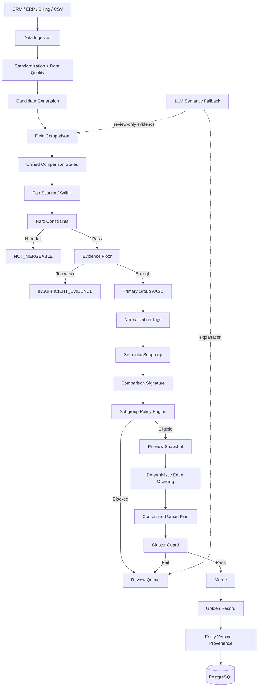

# MASTERONE — MASTER DATA ENTITY RESOLUTION
## Thiết kế hệ thống Entity Resolution và Auto Merge an toàn theo Group/Subgroup

> Phiên bản: `v3.1 — Mentor Revision + Conflict Taxonomy Fix`
>
> Mục tiêu: xây dựng hệ thống phát hiện, đánh giá và hợp nhất các bản ghi khách hàng trùng nhau giữa CRM / ERP / Billing / CSV theo hướng **an toàn, giải thích được, có HITL, audit, provenance, versioning và selective unmerge**.
>
> **Thay đổi v3 → v3.1 (phạm vi hẹp):** chỉ sửa lỗi *"Conflict chưa được định nghĩa nên Group D có thể phình to"*.
> Cụ thể: thêm state `DF`, thêm mục **8.1 Conflict Taxonomy**, làm rõ lại định nghĩa "non-hard conflict" ở mục 11.4, 13, 15.1, 16, bổ sung test T21–T28, metric ở mục 39, risk #11, P0 #9 và glossary.
> Số mục, kiến trúc, pipeline và các phần khác **giữ nguyên**.
>
> Thiết kế này giữ lại các điểm mạnh của phiên bản trước nhưng sửa các vấn đề trọng yếu được mentor chỉ ra: logic Group/Subgroup, comparison state, dữ liệu Việt Nam, hard constraint, ảnh hưởng gián tiếp của LLM, stale preview, cluster guard và rollback.

---

# 1. Phạm vi và giả định

## 1.1. Đối tượng dữ liệu

Phiên bản đầu tập trung vào **Customer Master Data** với hai loại entity:

```text
PERSON
ORGANIZATION
```

Các nguồn dữ liệu chính:

- CRM;
- ERP;
- Billing;
- CSV / Excel;
- Data Warehouse;
- dữ liệu import theo batch.

Các field chính:

```text
name
phone
email
dob
address
government_id
entity_type
source_system
source_record_id
```

## 1.2. Nguyên tắc an toàn

Hệ thống ưu tiên:

```text
Precision của Auto Merge > Coverage của Auto Merge
```

Nghĩa là:

- chấp nhận giữ lại nhiều pair cho Review;
- không auto merge nếu evidence chưa đủ chắc;
- một merge sai được xem là nghiêm trọng hơn một duplicate bị bỏ sót.

## 1.3. Phạm vi MVP

MVP cần có:

1. import dữ liệu từ nhiều nguồn;
2. chuẩn hóa dữ liệu;
3. candidate generation tránh `O(N²)`;
4. comparison + scoring;
5. hard constraint;
6. phân Group/Subgroup;
7. Auto Merge Policy;
8. Preview / Dry Run;
9. HITL Review;
10. Cluster Guard;
11. Golden Record;
12. audit + provenance;
13. selective unmerge;
14. benchmark theo subgroup.

Các phần có thể để sau MVP:

- Embedding ANN cho person name;
- agent tự điều phối phức tạp;
- incremental streaming real-time;
- downstream event bus đầy đủ;
- auto-learning online.

---

# 2. Nguyên tắc thiết kế cốt lõi

1. **Không so sánh toàn bộ `N²`.**
2. Candidate Generation phải ưu tiên **candidate recall cao**.
3. Score không phải trọng tài duy nhất.
4. Hard Constraint có quyền chặn merge dù score cao.
5. Primary Group chỉ dùng để biểu diễn **risk / decision context**, không dùng để mô tả mọi đặc điểm của pair.
6. Khác biệt do format/normalization được lưu dưới dạng **Normalization Tag**, không phải primary group.
7. Mỗi Semantic Subgroup có policy riêng.
8. Auto Merge ở cấp Group chỉ là batch action gọi policy của các Subgroup bên trong.
9. Group D không có Auto Merge toàn Group trong MVP.
10. LLM không được trực tiếp quyết định merge.
11. LLM evidence mặc định **không được dùng để bật Auto Merge**.
12. Mọi merge đều phải qua Preview và Cluster Guard.
13. Merge phải audit được, version được và unmerge chọn lọc được.
14. Pair-level PASS không đồng nghĩa cluster-level PASS.
15. Cùng một input và cùng policy version phải cho kết quả deterministic.

---

# 3. Kiến trúc tổng thể



Luồng quyết định chính:

```text
Raw Record
   ↓
Standardization
   ↓
Candidate Generation
   ↓
Field Comparison
   ↓
Unified State + Provenance
   ↓
Scoring
   ↓
Hard Constraint
   ↓
Evidence Floor
   ↓
Group A / C / D
   ↓
Semantic Subgroup
   ↓
Policy
   ↓
Preview
   ↓
Cluster Guard
   ↓
Merge / Review
```

---

# 4. Data Ingestion và dữ liệu nguồn

## 4.1. Record identity ổn định

Mỗi record phải có ID ổn định qua nhiều lần import:

```json
{
  "record_id": "internal_01H...",
  "source_system": "CRM",
  "source_record_id": "CRM_CUST_000123",
  "source_updated_at": "2026-09-30T10:00:00+07:00",
  "ingested_at": "2026-10-02T09:00:00+07:00"
}
```

Không nên tạo record ID mới mỗi lần re-import vì:

- negative edge sẽ mất tham chiếu;
- merge history không còn ổn định;
- steward decision không map được về record cũ.

## 4.2. Không overwrite raw value

Mỗi field nên lưu:

```text
raw_value
normalized_value
normalization_rule
quality_flag
normalization_version
```

Ví dụ:

```json
{
  "field": "phone",
  "raw_value": "0912 345 678",
  "normalized_value": "84912345678",
  "normalization_rule": "VN_MOBILE_V3",
  "quality_flag": "VALID"
}
```

## 4.3. Entity type

Bắt buộc lưu:

```text
PERSON
ORGANIZATION
UNKNOWN
```

Hard constraint:

```text
PERSON vs ORGANIZATION
→ NOT_MERGEABLE
```

---

# 5. Standardization cho dữ liệu Việt Nam

# 5.1. Name

Không được coi "bỏ dấu" là phép biến đổi luôn an toàn.

Cần lưu nhiều representation:

```text
name_original
name_unicode_normalized
name_lower
name_ascii
name_tokens
surname
middle_name
given_name
```

## Trường hợp A — cả hai tên đều có dấu

Ví dụ:

```text
Lê Văn An
Lê Văn Ân
```

Sau bỏ dấu đều có thể thành:

```text
le van an
```

Nhưng không được gọi là `NORMALIZED_EXACT`.

Quy tắc:

```text
both_have_diacritics = true
AND original_diacritic_form differs
AND only ASCII form matches
→ không được nâng thành NX
→ thường là MS hoặc CF tùy given name
```

## Trường hợp B — một bên có dấu, một bên không

```text
Nguyễn Văn An
Nguyen Van An
```

Có thể dùng trạng thái:

```text
NX_ASCII
```

nhưng sức mạnh thấp hơn `EXACT` trên bản có dấu.

## Trường hợp C — đảo thứ tự token

```text
Nguyễn Văn An
An Nguyen Van
```

Nên so sánh thêm token set / token order-independent representation.

## Given name

Given name cần trọng số riêng.

Ví dụ:

```text
Nguyễn Minh Khoa
Nguyễn Minh Khang
```

Không được coi là typo nhẹ chỉ vì toàn chuỗi khá giống.

---

# 5.2. Phone

Chuẩn hóa gồm:

```text
remove separators
normalize +84 / 0
validate prefix
map legacy 11-digit mobile → 10-digit mobile
normalize landline area code
separate extension
split multiple phone values
```

Ví dụ:

```text
0912345678
+84912345678
84912345678
```

→

```text
84912345678
```

Cần xử lý số di động cũ:

```text
0168xxxxxxx → 038xxxxxxx
0123xxxxxxx → 083xxxxxxx
...
```

Cần nhận diện placeholder:

```text
0000000000
0123456789
0999999999
```

và giá trị dùng chung:

```text
SHARED_PHONE
```

Một phone xuất hiện ở quá nhiều record khác tên không được dùng làm strong anchor.

---

# 5.3. Email

Chuẩn hóa cơ bản:

```text
lowercase
trim
validate local-part/domain
```

Có thể lưu thêm representation phụ:

```text
Gmail dot normalization
+tag removal
```

nhưng phải có flag riêng, không overwrite raw.

Nhận diện email role/shared:

```text
info@
admin@
ketoan@
sales@
```

và placeholder:

```text
test@test.com
noemail@
a@a.com
```

Những email này không được dùng làm anchor mạnh.

---

# 5.4. Address

Pipeline:

```text
Rule
 ↓ fail
Dictionary / Administrative Mapping
 ↓ fail
Fuzzy
 ↓ uncertain
LLM semantic fallback
```

Trước khi so sánh chuỗi toàn địa chỉ, nên parse thành:

```text
house_number
alley
street
ward
province
postal_code
```

Cần hỗ trợ mapping địa chỉ cũ ↔ mới sau thay đổi hành chính.

Lưu cả:

```text
admin_old_form
admin_current_form
mapping_version
```

Mapping nên hỗ trợ:

```text
many-to-many
```

thay vì giả định một địa chỉ cũ luôn map 1-1 sang địa chỉ mới.

Không nên dùng `district` làm blocking key bắt buộc vì dữ liệu mới có thể không còn cấp tương ứng.

---

# 5.5. DOB

Cần xử lý:

```text
dd/mm ↔ mm/dd
only year
placeholder date
invalid date
```

Ví dụ placeholder:

```text
1900-01-01
1970-01-01
01-01-YYYY
```

Các giá trị này không được tính `EXACT` mạnh nếu chỉ là giá trị mặc định của hệ thống nguồn.

---

# 5.6. Government ID

Lưu tách:

```text
id_type
id_value
id_quality
```

Ví dụ:

```text
CMND_9
CMND_12_OLD
CCCD_12
PASSPORT
TAX_ID
```

Quy tắc:

```text
same id_type + both VALID + different values
→ CF / có thể HARD_CONFLICT
```

Nhưng:

```text
CMND_9 vs CCCD_12
→ NC = NOT_COMPARABLE
```

không phải `CONFLICT`.

Có thể dùng cấu trúc CCCD như data quality check chéo với:

```text
DOB
gender
place code
```

nhưng không được tự suy ra identity chỉ từ các thành phần đó.

---

# 6. Data Quality

Bộ quality state chuẩn:

```text
VALID
INVALID
MISSING
SUSPICIOUS
SHARED
PLACEHOLDER
```

Quy tắc quan trọng:

```text
INVALID != CONFLICT
```

Ví dụ:

```text
phone A = "123"
phone B = "0912345678"
```

Không được kết luận:

```text
phone = CONFLICT
```

Mà nên:

```text
phone A quality = INVALID
comparison = IV / MI tùy policy
```

## 6.1. Frequency-based suspicious value

Theo dõi tần suất của:

```text
phone
email
address
name
```

Nếu một giá trị xuất hiện ở nhiều entity khác nhau:

```text
quality = SHARED
```

và không dùng làm identity anchor.

---

# 7. Candidate Generation / Blocking

Mục tiêu là tránh:

```text
O(N²)
```

Ví dụ 1 triệu record:

```text
~500 tỷ pair toàn phần
```

Không khả thi.

Thiết kế dùng multi-pass:

```text
Exact Blocking
    ∪
Composite Blocking
    ∪
TF-IDF Sparse Top-K
    ∪
Optional ANN
    ↓
Unique Candidate Pairs
```

Mỗi pair phải lưu:

```json
{
  "left_id": "crm_10",
  "right_id": "erp_99",
  "blocking_reasons": [
    "same_normalized_phone",
    "tfidf_name_dob_topk"
  ]
}
```

---

# 7.1. Exact Blocking

Các key mạnh:

```text
normalized_phone
normalized_email
same_type_government_id
```

Nhưng không tạo block lớn nếu value là `SHARED` hoặc có document frequency quá cao.

Ví dụ:

```text
phone → 3 records
```

có thể sinh pair.

Nhưng:

```text
company hotline → 10,000 records
```

không được all-pairs trong block.

---

# 7.2. Composite Blocking

Ví dụ phù hợp hơn với dữ liệu Việt Nam:

```text
name_prefix + birth_year
surname + birth_year
name_ascii + province
phone_suffix + birth_year
```

Tránh phụ thuộc cứng vào `district`.

---

# 7.3. TF-IDF Sparse Top-K

Dùng:

```text
character n-gram
      ↓
TF-IDF sparse vector
      ↓
sparse inverted index
      ↓
sparse nearest-neighbor / top-k search
```

Character n-gram hữu ích cho typo nhẹ và bỏ dấu, nhưng cần tránh n-gram quá phổ biến.

Ví dụ họ Nguyễn sinh ra các n-gram rất phổ biến:

```text
ngu
guy
uye
yen
```

Do đó cần:

```text
max_df / stop n-gram
posting-list cap
frequency-aware top-k
```

Không nên dùng chỉ `name` cho dữ liệu có nhiều tên phổ biến.

Nên kết hợp:

```text
name + birth_year
name + province
name + DOB feature
```

Top-K có thể động theo độ phổ biến của tên thay vì luôn cố định `K=10`.

---

# 7.4. Embedding ANN

Không phải thành phần bắt buộc của MVP cho person name.

Chỉ dùng nếu benchmark chứng minh có lợi cho:

```text
organization name
free-text
address hard case
```

Có thể dùng:

- FAISS;
- HNSW;
- pgvector.

---

# 8. Unified Comparison State Contract

Toàn hệ thống phải dùng một bộ state thống nhất.

| Code | Ý nghĩa |
|---|---|
| `EX` | EXACT |
| `NX` | NORMALIZED_EQUIVALENT |
| `NA` | NORMALIZED_ASCII_EQUIVALENT |
| `HS` | HIGH_SIMILAR |
| `MS` | MEDIUM_SIMILAR |
| `WS` | WEAK_SIMILAR |
| `CL` | CLOSE |
| `CF` | CONFLICT — có bằng chứng loại trừ (xem 8.1) |
| `DF` | DIFFERENT_NON_EXCLUSIVE — hai giá trị khác nhau nhưng chưa đủ bằng chứng loại trừ (xem 8.1) |
| `MI` | MISSING |
| `IV` | INVALID |
| `SH` | SHARED / SUSPICIOUS |
| `NC` | NOT_COMPARABLE |

Không dùng một state chung `SIMILAR` nếu policy cần phân biệt high/medium/weak.

Ví dụ pair:

```text
name          = HS
phone         = NX
email         = MI
dob           = EX
address       = HS
government_id = NC
```

---

## 8.1. Conflict Taxonomy — phân biệt `CF` và `DF`

> Mục này định nghĩa "conflict" cho toàn hệ thống. Mọi nơi dùng từ *conflict / non-hard conflict* (mục 13, 15, 16) đều tham chiếu về đây.

### Nguyên tắc

```text
Khác giá trị  ≠  Conflict
```

`CF` chỉ được dùng khi có **bằng chứng loại trừ**: không thể cùng một thực thể thật đồng thời mang cả hai giá trị này.

Hai giá trị khác nhau nhưng vẫn có thể cùng thuộc một thực thể (đổi số, đổi địa chỉ, nhiều email...) → `DF`.

Ba mức độ khác nhau:

```text
HARD_CONFLICT  (mục 11)  → NOT_MERGEABLE
CF             (non-hard conflict) → Group D
DF             → KHÔNG kích hoạt Group D
```

### Bảng định nghĩa theo field

| Field | `CF` khi | `DF` khi | Không phải `CF` / `DF` |
|---|---|---|---|
| `phone` | Cả hai `VALID`, không `SH`/`PLACEHOLDER`, **và** cả hai được nguồn đánh dấu primary/current, `source_updated_at` cùng nằm trong cửa sổ `W_current`, **và** nguồn được cấu hình `single_valued_reliable` cho field phone | Cả hai `VALID`, khác giá trị, nhưng không đủ điều kiện `CF` (ví dụ: không có cờ primary/current; một giá trị nằm trong lịch sử `valid_to` đã đóng; nguồn không đáng tin cho single-valued) | `IV`, `MI`, `SH`, `NC`; khác nhau chỉ do format/legacy mapping (→ `NX`) |
| `email` | Điều kiện tương tự `phone` (primary/current, cửa sổ `W_current`, nguồn `single_valued_reliable`, không `SH`/role/placeholder) | Hai email `VALID`, khác giá trị, không đủ điều kiện `CF` | `IV`, `MI`, `SH`; khác nhau chỉ do case/trim (→ `EX`/`NX`) |
| `name` | Cả hai name `VALID` và (surname khác sau chuẩn hóa **hoặc** given name khác mà **không** được giải thích bằng rule đáng tin cậy: typo 1 ký tự trên bản có dấu, viết tắt đã biết, nickname dictionary đã duyệt) | *(không dùng `DF` cho name — nếu không `CF` thì dùng mức similarity `NA`/`HS`/`MS`/`WS`)* | Khác do bỏ dấu một phía, đảo thứ tự token, thiếu/thừa tên đệm → xếp theo mức similarity, **không** `CF` |
| `dob` | Cả hai là full date `VALID`, không placeholder, không phải hoán đổi dd/mm↔mm/dd, và khác nhau; **hoặc** cả hai có năm hợp lệ và năm khác nhau | *(không dùng `DF`)* | Hoán đổi dd/mm↔mm/dd → `CL`; year-only vs full date cùng năm → không `CF`; placeholder → `IV`/`SH` |
| `address` | **Không bao giờ `CF`** — địa chỉ thay đổi theo thời gian và mapping hành chính có thể many-to-many | Hai địa chỉ khác nhau (không đạt `NX`/`HS`/`MS`/`WS`) | `MI`, `IV`; khác do viết tắt / mapping hành chính → `NX`/`HS` |
| `government_id` | *(không có mức `CF` non-hard)* | *(không dùng `DF`)* | Cùng `id_type`, cùng `VALID`, khác giá trị → **HARD_CONFLICT** (mục 11.2); khác `id_type` → `NC` |

Ghi chú: các mức similarity của name (`MS`/`WS`) không đồng nghĩa với việc pair được Auto Merge; việc đó vẫn do policy quyết định (mục 17, 18).

### Quy tắc chung

1. `IV`, `MI`, `SH`, `NC`, placeholder **không bao giờ** là `CF` hoặc `DF` — đây là trạng thái chất lượng / khả năng so sánh, không phải bằng chứng khác nhau (mở rộng nguyên tắc `INVALID != CONFLICT` ở mục 6).
2. `DF` **không kích hoạt Group D**. Với mục đích tính anchor, field ở trạng thái `DF` được coi là *anchor không thỏa* (tương tự chưa cung cấp được anchor) và chỉ ảnh hưởng đến quyết định A/C theo `missing_required_anchor_for_best_policy` (mục 16).
3. `DF` vẫn được ghi vào signature và vẫn được truyền vào bước scoring như một mức so sánh riêng; kiến trúc scoring không thay đổi.
4. Policy có thể đưa `DF` vào danh sách `forbidden` của một field cụ thể bằng cơ chế sẵn có ở mục 17.
5. `CF` chỉ được sinh bởi provenance `RULE`, `DICTIONARY` hoặc `STATISTICAL`. **LLM không được sinh `CF`** (nhất quán với nguyên tắc LLM không quyết định, mục 25).
6. Quyết định của steward không đổi state `CF`/`DF`; steward tạo `negative_edge` (mục 11.3).
7. Các tham số (`W_current`, danh sách nguồn `single_valued_reliable`, ngưỡng) nằm trong cấu hình có `conflict_rule_version`, được lưu trong `method_version` của comparison (mục 9) để tái lập kết quả.

### Ví dụ

```text
phone A = 0912345678, phone B = 0987654321
cả hai VALID, không có cờ primary/current
→ P:DF   (không vào Group D)

phone A, B khác nhau, cả hai primary/current trong W_current,
nguồn single_valued_reliable
→ P:CF   (vào Group D)

address Hà Nội vs TP.HCM, các field khác khớp
→ A:DF   (không vào Group D, không bao giờ CF)

DOB 1999-05-12 vs 1999-12-05
→ DOB:CL (không CF)

DOB 1999-05-12 vs 1998-05-12
→ DOB:CF (vào Group D)

phone A = 0912345678 (valid_to đã đóng trong lịch sử entity)
phone B = 0987654321 (hiện hành)
→ P:DF
```

---

# 9. Comparison Provenance

Mỗi comparison state phải lưu nguồn sinh evidence:

```text
RULE
DICTIONARY
FUZZY
STATISTICAL
LLM
STEWARD
```

Ví dụ:

```json
{
  "field": "address",
  "state": "HS",
  "provenance": "FUZZY",
  "score": 0.87,
  "method_version": "ADDR_FUZZY_V2"
}
```

hoặc:

```json
{
  "field": "address",
  "state": "HS",
  "provenance": "LLM",
  "score": null,
  "model_version": "...",
  "prompt_version": "ADDR_SEM_V3"
}
```

Provenance này được dùng trực tiếp trong policy.

---

# 10. Pair Scoring

Có thể dùng Splink / probabilistic record linkage.

Input:

```text
comparison states
term frequency
source reliability
data quality
```

Output nên lưu:

```text
match_weight
match_probability
```

Khuyến nghị dùng `match_weight` làm tín hiệu policy dễ kiểm soát hơn, còn probability dùng cho UI / báo cáo nếu đã calibration.

## 10.1. Term-frequency adjustment

Tên phổ biến:

```text
Nguyễn Văn An
```

mang ít evidence hơn tên hiếm.

Tương tự:

```text
shared phone
shared email
common address
```

cần giảm trọng số.

## 10.2. Calibration

Các ngưỡng như:

```text
0.995
0.998
```

chỉ là giá trị khởi tạo.

Phải hiệu chỉnh trên labeled ground truth theo từng subgroup trước khi dùng production.

---

# 11. Hard Constraints

Hard Constraint luôn chạy trước Grouping.

## 11.1. Person vs Organization

```text
PERSON vs ORGANIZATION
→ HARD_CONFLICT
```

## 11.2. Same-type Government ID conflict

```text
CCCD_12 A != CCCD_12 B
AND both VALID
→ HARD_CONFLICT
```

Nhưng:

```text
CMND_9 vs CCCD_12
→ NC
```

## 11.3. Steward negative decision

Nếu steward đã xác nhận:

```text
A != B
```

thì lưu `negative_edge` và không được tự merge lại trừ khi có workflow override được audit.

## 11.4. Verified identity conflict

Phone/email khác nhau chỉ là hard conflict nếu policy xác định chúng là **verified strong identifiers**, ví dụ:

```text
OTP_VERIFIED_PHONE
VERIFIED_PRIMARY_EMAIL
```

Phone/email thường không tự động là hard conflict.

Phone/email khác nhau thông thường được xếp `DF`, hoặc `CF` nếu thỏa điều kiện ở mục 8.1; trong cả hai trường hợp đều **không** phải hard conflict.

---

# 12. Evidence Floor

Trước khi phân Group, pair phải đạt evidence tối thiểu.

Ví dụ:

```text
match_weight >= W_MIN
AND count_valid_anchors >= 1
```

Nếu không đạt:

```text
INSUFFICIENT_EVIDENCE
```

không được rơi xuống Group C/A chỉ vì có missing.

## 12.1. Anchor

Strong anchor gợi ý:

```text
same-type government_id EX + VALID
phone EX/NX + VALID + not SHARED
email EX/NX + VALID + not SHARED
```

Supporting evidence:

```text
DOB EX
name HS
address HS
```

Anchor phải configurable theo domain.

---

# 13. Primary Group — thiết kế mới

Primary Group chỉ còn:

```text
A — Strong / clean evidence
C — Missing required anchor
D — Non-hard conflict
```

`B — Format / Normalization` không còn là primary group.

B được chuyển thành **Normalization Tags**.

## 13.1. Group D — Conflict

Non-hard conflict được định nghĩa là: **ít nhất một field có state `CF` theo mục 8.1**.

State `DF` **không** phải conflict.

Nếu có bất kỳ non-hard conflict nào:

```text
→ Group D
```

Pair không được rơi xuống C/A.

Ví dụ:

```text
name    = HS
phone   = CF
email   = EX
dob     = EX
→ D
```

Ví dụ phone khác nhau nhưng không đủ bằng chứng loại trừ:

```text
name    = HS
phone   = DF
email   = EX
dob     = EX
→ không vào D
→ xét A/C theo anchor mà policy yêu cầu
```

## 13.2. Group C — Missing Required Anchor

Không có conflict nhưng thiếu anchor mà policy cần.

Ví dụ:

```text
name  = HS
phone = MI
email = EX
dob   = EX
→ C
```

Field ở state `DF` được tính là anchor chưa thỏa (mục 8.1, quy tắc 2).

## 13.3. Group A — Strong / Clean

Không hard conflict, không non-hard conflict và có đủ anchor.

Ví dụ:

```text
name  = NA
phone = NX
dob   = EX
email = MI
```

Có thể vẫn là A nếu policy A1 chỉ cần name + phone và email không phải required anchor cho A1.

Đây là điểm khác phiên bản cũ: `missing` không còn tự động đẩy mọi pair vào C. Chỉ thiếu **required anchor của policy** mới đẩy vào C.

---

# 14. Normalization Tags — thay cho Group B

Các tag dùng để giải thích raw difference:

```text
NAME_ASCII_EQUIVALENT
PHONE_FORMAT_EQUIVALENT
EMAIL_CASE_EQUIVALENT
ADDRESS_ADMIN_MAPPING
ADDRESS_ABBREVIATION
TOKEN_ORDER_VARIATION
LEGACY_PHONE_MAPPING
```

Ví dụ:

```json
{
  "primary_group": "A",
  "normalization_tags": [
    "NAME_ASCII_EQUIVALENT",
    "PHONE_FORMAT_EQUIVALENT"
  ]
}
```

Tag không tự quyết định risk tier.

---

# 15. Semantic Subgroup và Comparison Signature

Hệ thống có ba cấp rõ ràng:

```text
Primary Group
   ↓
Semantic Subgroup
   ↓
Comparison Signature
```

## 15.1. Semantic Subgroup

Đây là cấp gắn policy.

Ví dụ Group A:

```text
A1 — Name + Phone
A2 — Name + Email
A3 — Phone + DOB + compatible name
```

Group C:

```text
C1 — Missing phone but email + DOB strong
C2 — Missing email but phone + name strong
C3 — Missing address but identity anchors strong
C_MULTI — Multiple required fields missing
```

Group D:

```text
D1 — Name similar + Phone CF
D2 — Phone same + Name CF/suspicious
D3 — Address same + Identity field CF (name/phone/email/dob)
D4 — DOB CF but other evidence strong
D_MULTI — Multiple CF fields (non-hard)
```

Trong Group D, `CF` luôn hiểu theo mục 8.1. Pair chỉ có `DF` không thuộc Group D.

## 15.2. Comparison Signature

Signature dùng để:

- thống kê;
- UI;
- benchmark;
- debug;
- drift monitoring.

Ví dụ:

```text
N:HS|P:CF|E:EX|DOB:EX|A:HS|G:NC
```

Không rút gọn HS/MS/WS thành một `S` vì policy có thể phân biệt các mức này.

## 15.3. Pair match nhiều subgroup

Lưu:

```json
{
  "matched_subgroups": ["A1", "A2", "A3"],
  "decision_subgroup": "A3"
}
```

`decision_subgroup` được chọn bằng **deterministic conservative priority**.

Ví dụ:

```yaml
subgroup_priority:
  A:
    - A3
    - A2
    - A1
```

Thứ tự cuối cùng phải được benchmark, version và test.

---

# 16. Pseudocode Grouping

```python
def classify_pair(pair):
    if has_hard_conflict(pair):
        return {
            "decision": "NOT_MERGEABLE",
            "reason": "HARD_CONFLICT"
        }

    if pair.match_weight < W_MIN or count_valid_anchors(pair) < 1:
        return {
            "decision": "INSUFFICIENT_EVIDENCE"
        }

    tags = detect_normalization_tags(pair)

    if has_non_hard_conflict(pair):  # chỉ state CF theo 8.1; DF không tính
        group = "D"
        subgroup = select_conservative_d_subgroup(pair)

    elif missing_required_anchor_for_best_policy(pair):
        group = "C"
        subgroup = select_conservative_c_subgroup(pair)

    else:
        group = "A"
        subgroup = select_conservative_a_subgroup(pair)

    return {
        "decision": "MERGEABLE",
        "group": group,
        "subgroup": subgroup,
        "normalization_tags": tags,
        "signature": build_signature(pair)
    }
```

Định nghĩa `has_non_hard_conflict`:

```python
def has_non_hard_conflict(pair):
    # CF theo mục 8.1. DF, IV, MI, SH, NC không tính là conflict.
    return any(c.state == "CF" for c in pair.comparisons.values())
```

Nguyên tắc:

```text
Conflict không bao giờ bị che bởi Missing.
Khác giá trị (DF) không phải conflict.
Missing không tự động làm pair rủi ro nếu anchor cần thiết vẫn đủ.
Normalization chỉ là tag.
```

---

# 17. Auto Merge Policy Engine

Mỗi Semantic Subgroup có:

```text
policy_id
policy_version
required states
forbidden states
minimum match_weight
allow_llm_evidence
batch_limit
approval_level
```

Ví dụ:

```yaml
policy_id: A1
version: 3
required:
  phone:
    states: [EX, NX]
    quality: [VALID]
    allow_shared: false
  name:
    states: [EX, NX, NA, HS]
forbidden:
  government_id: [CF]
minimum_match_weight: 10.5
allow_llm_evidence: false
cluster_guard_required: true
```

## 17.1. Auto Merge cấp Group

Không dùng một threshold chung cho cả Group.

Ví dụ người dùng bấm:

```text
Group A [Auto Merge]
```

Backend thực chất chạy:

```text
A1 → policy A1_v3
A2 → policy A2_v2
A3 → policy A3_v4
```

rồi union kết quả eligible.

## 17.2. Group D

MVP:

```text
Không có [Auto Merge] toàn Group D.
```

Có thể cho phép một số D-subgroup riêng nhưng phải:

- policy rất chặt;
- batch nhỏ;
- Senior Steward hoặc four-eyes approval;
- không được dựa vào LLM evidence.

---

# 18. Siết policy A3 và D2

## A3 — Phone + DOB

Không đủ nếu chỉ:

```text
phone EX + dob EX
```

Vì sinh đôi / thành viên gia đình có thể dùng chung phone và DOB.

A3 cần thêm:

```text
given_name compatible
phone not SHARED
no same-source unique-key conflict
```

Ví dụ:

```text
Khoa vs Khang
same phone
same DOB
same address
```

→ không Auto Merge.

## D2 — Phone same + Name different

Mặc định Review nếu given name khác rõ.

Chỉ auto merge nếu khác biệt tên được giải thích bằng rule đáng tin cậy:

```text
1-char typo trên bản có dấu
known abbreviation
approved nickname dictionary
```

không dựa vào similarity toàn chuỗi đơn thuần.

---

# 19. Preview / Dry Run

Preview bắt buộc trước execute.

Preview phải là snapshot có version:

```json
{
  "preview_id": "pv_001",
  "policy_versions": ["A1_v3", "A2_v2"],
  "pair_set_hash": "...",
  "entity_versions": {
    "entity_01": 5,
    "entity_09": 2
  },
  "created_at": "...",
  "expires_at": "..."
}
```

Preview hiển thị:

```text
Selected pairs
Eligible pairs
Review required
Cluster guard failed
Entities affected
Estimated merge count
Policy version
```

## 19.1. Stale Preview

Khi Execute:

```text
check preview expiry
    ↓
check entity versions
    ↓
check policy version
    ↓
re-run critical guards
    ↓
execute
```

Nếu state thay đổi:

```text
pair → REVIEW / PREVIEW_EXPIRED
```

## 19.2. Idempotency

Cùng một:

```text
preview_id + execute_request_id
```

không được tạo merge lần hai.

---

# 20. Deterministic Constrained Union-Find

Pair eligible vẫn chưa được merge ngay.

Trước Union-Find phải sắp cạnh:

```text
match_weight DESC
then pair_id ASC
```

Ví dụ:

```text
A-B weight = 12.5
B-C weight = 9.7
A ≁ C
```

xử lý A-B trước.

Nếu B-C bị block:

```text
B-C → REVIEW
reason = BLOCKED_BY_NEGATIVE_EDGE_A_C
```

Audit phải lưu thứ tự edge processing.

---

# 21. Cluster Guards

Cluster Guard kiểm tra:

```text
cluster hiện tại của left entity
+
cluster hiện tại của right entity
+
proposed union
```

không chỉ pair trong batch.

## 21.1. Unique ID Guard

Không được tạo cluster có:

```text
2 CCCD hợp lệ khác nhau cùng type
```

## 21.2. Negative Edge Guard

Nếu tồn tại:

```text
A ≠ C
```

không merge cluster chứa A với cluster chứa C.

## 21.3. Same-source Unique Key Guard

Ví dụ một nguồn CRM cam kết mỗi customer_id đại diện một người.

Không nên tạo một entity chứa:

```text
CRM_001
CRM_999
```

nếu nguồn đó được cấu hình là source-unique.

## 21.4. Shared-value Guard

Cluster sinh ra chủ yếu do shared phone/email/address phải bị hạ độ tin cậy hoặc chặn.

## 21.5. Cluster Anomaly

Không dùng cố định chỉ:

```text
cluster_size > 20
```

mà nên theo:

```text
source distribution
shared identifiers
unique-key conflict
sudden component growth
```

---

# 22. Golden Record

Golden Record không chỉ chọn một record "tốt nhất".

Survivorship rule theo field:

```text
source reliability
verified flag
quality
recency
steward decision
```

Ví dụ:

```json
{
  "name": {
    "value": "Nguyễn Văn An",
    "source": "CRM",
    "record_id": "crm_123"
  }
}
```

## 22.1. Multi-valued attributes

Phone/email/address nên có thể giữ nhiều giá trị:

```json
{
  "phones": [
    {
      "value": "84912345678",
      "valid_from": "2024-01-01",
      "valid_to": null,
      "source": "CRM"
    },
    {
      "value": "84987654321",
      "valid_from": "2021-01-01",
      "valid_to": "2023-12-31",
      "source": "ERP"
    }
  ]
}
```

Điều này phù hợp với trường hợp khách đổi phone thay vì coi phone cũ và mới là conflict tuyệt đối.

---

# 23. Provenance, Versioning và Audit

Mỗi merge event cần lưu:

```text
initiated_by
decided_by
policy_id
policy_version
run_id
preview_id
pair_ids
edge_order
cluster_guard_results
entity_version_before
entity_version_after
created_at
```

Phân biệt:

```text
initiated_by = người bấm nút
```

và:

```text
decided_by = A1_v3 / Steward / SeniorSteward
```

Không dùng chung một field `approved_by = system_policy`.

---

# 24. Selective Unmerge / Rollback

Không dùng đơn thuần:

```text
restore previous version
```

Ví dụ:

```text
v1 [A,B]
v2 [A,B,C]   ← C merge sai
v3 [A,B,C,D] ← D merge đúng
```

Rollback C phải tạo:

```text
v4 [A,B,D]
```

và:

```text
entity_C = [C]
```

không được quay về v1 và làm mất D.

Khi unmerge:

1. chọn member / edge cần tách;
2. recompute connected component hợp lệ;
3. tạo entity version mới;
4. recompute golden record;
5. tạo negative edge để tránh re-merge tự động;
6. phát audit event `ENTITY_SPLIT`.

---

# 25. LLM và Semantic Fallback

LLM chỉ dùng khi:

```text
Rule fail
 ↓
Dictionary fail
 ↓
Fuzzy uncertain
 ↓
LLM semantic fallback
```

Ứng dụng phù hợp:

- address abbreviation phức tạp;
- organization name;
- free-text notes;
- chuỗi khó chuẩn hóa bằng rule.

## 25.1. LLM không được bật Auto Merge mặc định

Default:

```yaml
allow_llm_evidence: false
```

Nếu state đến từ LLM:

```json
{
  "state": "HS",
  "provenance": "LLM",
  "eligible_for_auto_merge": false
}
```

→ Review.

Chỉ policy đã benchmark và được phê duyệt mới có thể bật:

```yaml
allow_llm_evidence: true
```

## 25.2. Reproducibility

Cache theo:

```text
normalized_input_hash
model_version
prompt_version
```

Audit lưu:

```text
model_version
prompt_version
response_hash
created_at
```

## 25.3. LLM Explanation

Số liệu phải sinh deterministic từ backend.

LLM chỉ diễn giải:

```text
1,840 / 2,000 pair eligible
```

không được tự tạo hoặc sửa con số.

---

# 26. PII, Security và Governance

Dữ liệu có thể chứa:

```text
name
phone
email
address
DOB
government ID
```

Nếu dùng external LLM cần có review pháp lý / data processing policy phù hợp.

Ưu tiên:

```text
masking / tokenization
self-hosted model nếu cần
minimum necessary fields
```

## 26.1. RBAC

### Viewer

- đọc dữ liệu;
- PII masking;
- không approve/reject.

### Steward

- review pair;
- approve/reject;
- auto merge subgroup rủi ro thấp.

### Senior Steward

- batch lớn;
- D-subgroup;
- selective unmerge;
- override có lý do.

### Policy Admin

- sửa policy/threshold;
- simulate policy;
- không tự phê duyệt policy mình thay đổi.

### Auditor

- đọc audit;
- xem history;
- không sửa quyết định.

---

# 27. Review Queue

Không chỉ sort theo score giảm dần.

Nên nhóm theo:

```text
Group
→ Semantic Subgroup
→ Signature Bucket
```

Ví dụ:

```text
D1 — Name similar + Phone CF
  ├── N:HS|P:CF|E:EX|DOB:EX|A:HS
  ├── N:EX|P:CF|E:EX|DOB:EX|A:HS
  └── N:HS|P:CF|E:MI|DOB:EX|A:EX
```

UI pair review cần:

- side-by-side raw value;
- normalized value;
- highlight differences;
- quality state;
- evidence provenance;
- blocking reason;
- score / weight;
- policy result;
- cluster impact preview;
- negative edge warning.

---

# 28. Data Model gợi ý

## 28.1. Pair decision

```json
{
  "pair_id": "p_001",
  "left_id": "crm_10",
  "right_id": "erp_99",

  "blocking_reasons": [
    "same_normalized_phone",
    "tfidf_name_birthyear_topk"
  ],

  "comparisons": {
    "name": {
      "state": "NA",
      "provenance": "RULE"
    },
    "phone": {
      "state": "NX",
      "provenance": "RULE"
    },
    "email": {
      "state": "MI",
      "provenance": "RULE"
    },
    "dob": {
      "state": "EX",
      "provenance": "RULE"
    },
    "address": {
      "state": "HS",
      "provenance": "FUZZY"
    },
    "government_id": {
      "state": "NC",
      "provenance": "RULE"
    }
  },

  "match_weight": 11.7,
  "match_probability": 0.992,

  "decision": "MERGEABLE",
  "primary_group": "A",
  "matched_subgroups": ["A1", "A3"],
  "decision_subgroup": "A3",
  "normalization_tags": [
    "NAME_ASCII_EQUIVALENT",
    "PHONE_FORMAT_EQUIVALENT"
  ],
  "signature": "N:NA|P:NX|E:MI|DOB:EX|A:HS|G:NC",

  "policy": {
    "policy_id": "A3",
    "policy_version": 4,
    "eligible": true
  }
}
```

---

# 29. PostgreSQL Schema gợi ý

```text
records
record_field_values
normalized_records
candidate_pairs
blocking_evidence
pair_comparisons
pair_scores
pair_decisions
normalization_tags
policy_definitions
policy_evaluations
preview_snapshots
review_cases
negative_edges
entities
entity_members
entity_versions
golden_field_values
merge_events
split_events
audit_logs
jobs
runs
```

Các bảng `negative_edges` và `policy_evaluations` nên tách riêng để query guard nhanh và audit policy dễ hơn.

---

# 30. API gợi ý

## Query

```http
GET /resolution/groups
GET /resolution/groups/{group}/subgroups
GET /resolution/pairs/{pair_id}
GET /entities/{entity_id}
GET /entities/{entity_id}/history
```

## Review

```http
POST /resolution/pairs/{pair_id}/decision
```

## Auto Merge

```http
POST /resolution/auto-merge/preview
POST /resolution/auto-merge/execute
```

## Split / rollback

```http
POST /entities/{entity_id}/split
```

## Policy

```http
POST /policies/{policy_id}/simulate
```

Execute cần:

```text
preview_id
idempotency_key
expected policy version
```

---

# 31. Worker và xử lý batch

Worker nên xử lý:

```text
import
normalize
candidate generation
comparison
scoring
policy evaluation
preview build
merge execution
benchmark
```

Idempotency theo:

```text
run_id + batch_id + step
```

Với dữ liệu lớn:

```text
Object Storage
    ↓
chunk read
    ↓
normalize / persist global record state
    ↓
global blocking index
    ↓
candidate generation
```

Chunk upload không được giới hạn matching trong cùng chunk. Candidate generation phải dựa trên index/global storage sau ingest.

---

# 32. Object Storage

Dùng cho:

```text
raw CSV
Parquet
large imports
benchmark datasets
exports
model artifacts
snapshot files
```

Database không cần giữ toàn bộ raw file blob.

---

# 33. Benchmark và Ground Truth

Không benchmark chỉ overall.

## 33.1. Candidate Generation

Đo:

```text
candidate_recall
reduction_ratio
pairs_per_record
candidate_count
runtime
```

## 33.2. Pair Matching

Đo:

```text
precision
recall
F1
PR-AUC
calibration
```

## 33.3. Auto Merge

Đo:

```text
auto_merge_precision
auto_merge_coverage
review_rate
rollback_rate
```

## 33.4. Cluster-level

Đo thêm:

```text
pairwise precision after transitive closure
B-cubed precision/recall
cluster purity
```

## 33.5. Theo subgroup

Ví dụ:

```text
A1 precision
A2 precision
A3 precision
C1 precision
D1 precision
```

Không dùng một threshold chung.

---

# 34. Xây Ground Truth

Lấy mẫu phân tầng theo:

```text
Semantic Subgroup
+
score / match_weight range
+
source pair
+
normalization tag
```

Ground truth gồm:

1. public benchmark như FEBRL;
2. synthetic Vietnam dataset;
3. steward-labeled sample;
4. hard negative cases.

Vietnam synthetic cần có:

```text
An vs Ân
An vs Anh
11-digit → 10-digit phone
shared family phone
CMND vs CCCD
address old/new admin form
placeholder DOB
shared email
organization/person collision
```

## 34.1. Cỡ mẫu

Không tuyên bố precision 99.9% từ sample quá nhỏ.

Nếu một subgroup chưa có đủ sample để chứng minh rủi ro thấp:

```text
→ Review mặc định
```

---

# 35. Regression Test Suite bắt buộc

## T1

Tên bỏ dấu + phone khác format, đủ anchor.

```text
→ Group/subgroup đúng sau thiết kế mới
```

## T2

```text
Lê Văn An vs Lê Văn Ân
same phone
```

→ không được coi name NX chỉ vì bỏ dấu.

## T3

```text
Nguyễn Văn An vs Nguyễn Văn Anh
same address
```

→ không Auto Merge.

## T4

Sinh đôi:

```text
name different
same phone
same DOB
same address
```

→ không Auto Merge.

## T5

Vợ chồng dùng chung phone/email.

→ shared value không là strong anchor.

## T6

CMND 9 vs CCCD 12.

→ `NC`, không HARD_CONFLICT.

## T7

Hai CCCD 12 khác nhau, valid.

→ NOT_MERGEABLE.

## T8

CCCD metadata không khớp DOB.

→ SUSPICIOUS quality flag.

## T9

Legacy 11-digit phone vs mapped 10-digit.

→ NX.

## T10

Placeholder/shared phone.

→ không là anchor; không tạo huge block.

## T11

Address old admin form vs new form.

→ NX qua mapping nếu evidence đủ.

## T12

DOB dd/mm vs mm/dd ambiguity.

→ CL, không EX.

## T13

Phone `CF` (theo 8.1) + evidence yếu.

→ không được rơi xuống A/C.

## T14

```text
A~B
B~C
A≁C
```

→ deterministic edge order; one edge blocked.

## T15

Preview xong có negative edge mới.

→ execute phải reject stale pair.

## T16

Execute cùng preview hai lần.

→ lần hai no-op.

## T17

Merge sai C, merge đúng D sau đó, unmerge C.

→ D vẫn ở entity.

## T18

Pair chỉ đủ policy nhờ LLM evidence.

→ không Auto Merge nếu `allow_llm_evidence=false`.

## T19

PERSON vs ORGANIZATION cùng phone.

→ NOT_MERGEABLE.

## T20

Nhiều record cùng tên phổ biến, chỉ một record đúng có birth-year phù hợp.

→ Candidate Generation vẫn lấy được candidate đúng.

## T21

Phone khác nhau, cả hai `VALID`, không có cờ primary/current.

→ `P:DF`, không vào Group D.

## T22

Phone khác nhau, cả hai primary/current trong `W_current`, nguồn `single_valued_reliable`.

→ `P:CF`, vào Group D.

## T23

Phone cũ (đã có `valid_to` trong lịch sử entity) vs phone mới hiện hành.

→ `P:DF`, không `CF`.

## T24

Address khác hoàn toàn, các field khác khớp.

→ `A:DF`; address không bao giờ `CF`; không vào Group D.

## T25

DOB hoán đổi dd/mm↔mm/dd → `CL`, không `CF`.

DOB khác năm (cả hai full date `VALID`) → `CF`, vào Group D.

## T26

Phone khác nhau nhưng một bên `SH` hoặc `IV`.

→ state là `SH`/`IV`, không phải `CF` hoặc `DF`.

## T27

`name=EX`, `phone=DF`, `email=EX`, `dob=EX`.

→ không vào Group D; xét A/C theo anchor của policy.

## T28

Evidence từ LLM cố đẩy một field lên `CF`.

→ không hợp lệ; `CF` chỉ sinh từ `RULE`/`DICTIONARY`/`STATISTICAL`.

---

# 36. Active Learning

Feedback steward được lưu làm training/evaluation data.

Không update model/policy ngay sau mỗi click.

Quy trình:

```text
Collect feedback
    ↓
Build labeled set
    ↓
Offline evaluation
    ↓
Policy/model candidate
    ↓
Simulation
    ↓
Approval
    ↓
Deploy new version
```

Theo dõi:

```text
precision delta
coverage delta
review rate delta
rollback rate delta
```

---

# 37. Incremental Matching — hướng nâng cấp

Sau batch đầu, phần lớn workload sẽ là:

```text
new record
    ↓
record-to-entity candidate search
    ↓
compare with representative / members
    ↓
attach / new entity / review
```

Không nên re-run toàn bộ all-record matching mỗi khi có vài record mới.

Trigger re-evaluation khi:

```text
record updated
new identity field appears
negative edge added
policy version changes
source delete occurs
```

---

# 38. Downstream Synchronization

Khi merge/split nên phát event:

```text
ENTITY_MERGED
ENTITY_SPLIT
GOLDEN_RECORD_UPDATED
```

Dùng transactional outbox để tránh database đã commit nhưng event chưa phát.

Downstream có thể gồm:

```text
CRM
ERP
Billing
Warehouse
Analytics
```

---

# 39. Monitoring và vận hành

Theo dõi:

```text
candidate count
candidate recall sample
pairs per record
review backlog
review SLA
auto merge count
auto merge precision sample
rollback rate
cluster-size distribution
shared-value distribution
signature distribution
LLM call rate
LLM cost
policy-version performance
cf_rate_by_field
df_rate_by_field
group_D_share_of_pairs
```

Drift alert khi:

```text
signature distribution thay đổi mạnh
shared phone tăng bất thường
new source format xuất hiện
review rate tăng đột biến
group D share hoặc cf_rate_by_field tăng đột biến
rollback rate tăng
```

---

# 40. Phân quyền batch và approval

Ví dụ rule vận hành:

```text
A1 low-risk subgroup
≤ 1,000 pairs
→ Steward

A-group batch > 10,000 pairs
→ Senior Steward

D1/D2 restricted
→ Senior Steward + second approval

Policy change
→ Policy Admin + separate approver
```

Con số cụ thể cần benchmark và business approval trước production.

---

# 41. State Machine đề xuất

```text
CANDIDATE
→ SCORED
→ HARD_BLOCKED
OR
→ GROUPED
→ POLICY_EVALUATED
→ REVIEW_REQUIRED
OR
→ PREVIEWED
→ EXPIRED
OR
→ EXECUTING
→ MERGED
→ SUPERSEDED
OR
→ SPLIT / ROLLED_BACK
```

Phân biệt:

```text
POLICY_BLOCKED = pair không đạt policy tự động
REVIEW_REQUIRED = pair cần người xem
HARD_BLOCKED = hard constraint
```

---

# 42. Known Risks

1. Person name phổ biến gây candidate explosion.
2. Shared family phone/email gây false merge.
3. Old/new government IDs gây false conflict.
4. Vietnamese diacritics gây false normalized match.
5. Address administrative changes gây false negative.
6. Transitive closure gây cluster contamination.
7. LLM evidence có thể không ổn định.
8. Stale preview gây merge trên state cũ.
9. Policy threshold chưa calibration gây confidence ảo.
10. Review backlog lớn có thể dẫn đến human rubber-stamping.
11. Định nghĩa conflict quá rộng (coi mọi giá trị khác nhau là `CF`) làm Group D phình to và làm loãng hàng đợi Review.

---

# 43. Glossary

| Thuật ngữ | Ý nghĩa |
|---|---|
| Candidate Pair | Cặp record được chọn để so sánh |
| Anchor | Field identity mạnh đủ tin cậy |
| Comparison State | Trạng thái EX/NX/HS/... của một field |
| CF (Conflict) | Có bằng chứng loại trừ giữa hai giá trị; chỉ `CF` mới đưa pair vào Group D |
| DF (Different, non-exclusive) | Hai giá trị khác nhau nhưng chưa đủ bằng chứng loại trừ; không đưa pair vào Group D |
| Provenance | Nguồn sinh evidence: Rule/Dict/Fuzzy/LLM/... |
| Primary Group | A/C/D — context rủi ro chính |
| Normalization Tag | Nhãn giải thích khác biệt format |
| Semantic Subgroup | Pattern nghiệp vụ gắn policy |
| Signature | Pattern comparison chi tiết của pair |
| Policy | Điều kiện deterministic quyết định eligible/review |
| Preview | Snapshot trước execute |
| Negative Edge | Quan hệ xác nhận hai record/entity không được merge |
| Cluster Guard | Guard kiểm tra proposed entity cluster |
| Golden Record | Master representation của entity |
| Selective Unmerge | Tách một phần merge sai mà không mất merge đúng sau đó |

---

# 44. Ưu tiên triển khai

## P0 — bắt buộc trước khi triển khai Auto Merge

1. Group A/C/D + B as tag.
2. Unified comparison state.
3. Government ID theo type.
4. Vietnamese name rule.
5. Shared-value detection.
6. A3/D2 safe policy.
7. LLM provenance + `allow_llm_evidence=false`.
8. deterministic subgroup selection.
9. Conflict taxonomy (`CF` vs `DF`) + `conflict_rule_version`.

## P1 — cần có trong MVP

1. legacy Vietnam phone mapping;
2. address administrative mapping;
3. stale-preview protection;
4. idempotent execute;
5. deterministic Constrained Union-Find;
6. source-unique cluster guard;
7. selective unmerge;
8. RBAC nhiều cấp;
9. ground truth + benchmark;
10. PII governance.

## P2 — nâng cấp

1. incremental record-to-entity;
2. downstream event bus;
3. richer multi-valued golden attributes;
4. drift monitoring;
5. ANN nếu benchmark chứng minh lợi ích;
6. Resolution Agent nếu có use case rõ ràng.

---

# 45. Kế hoạch triển khai 3 tuần gợi ý

## Tuần 1 — Core correctness

```text
Data contracts
Standardization
Data Quality
Unified Comparison State
Candidate Generation
Splink scoring
Hard Constraints
Group/Subgroup logic
Regression tests P0
```

## Tuần 2 — Auto Merge safety

```text
Policy Engine
Preview Snapshot
Review Queue
Constrained Union-Find
Cluster Guards
Golden Record
Provenance
Versioning
Selective Unmerge
```

## Tuần 3 — Evaluation + Demo

```text
Ground Truth
Benchmark
Policy calibration
Vietnam edge cases
LLM fallback + audit
RBAC
Monitoring summary
Demo workflow
Documentation
```

---

# 46. End-to-End Example

Input:

```text
CRM
Nguyễn Văn An
0912345678
an.nguyen@gmail.com
1999-05-12
10 Nguyễn Trãi, Hà Nội

ERP
Nguyen Van An
+84912345678
NULL
1999-05-12
10 Nguyen Trai, HN
```

## Standardization

```text
name:
Nguyễn Văn An ↔ Nguyen Van An
→ NA

phone:
0912345678 ↔ +84912345678
→ NX

email:
value ↔ missing
→ MI

dob:
exact
→ EX

address:
normalized/fuzzy equivalent
→ HS/NX tùy method
```

## Provenance

```text
name  NA  RULE
phone NX  RULE
email MI  RULE
dob   EX  RULE
addr  HS  FUZZY
```

## Hard Constraint

```text
PASS
```

## Evidence Floor

```text
phone anchor + DOB support + name support
→ PASS
```

## Group

Không có conflict.

Email missing nhưng A1 không yêu cầu email làm anchor.

```text
Primary Group = A
```

Normalization Tags:

```text
NAME_ASCII_EQUIVALENT
PHONE_FORMAT_EQUIVALENT
ADDRESS_ABBREVIATION
```

Matched subgroup:

```text
A1
A3
```

Policy engine chọn conservative decision subgroup theo policy version hiện hành.

Nếu eligible:

```text
Preview
→ Cluster Guard
→ Merge
→ Golden Record
→ Entity Version
```

---

# 47. Ví dụ Hard Case có LLM

```text
12 N.Trãi, TX Trung, HN
vs
12 Nguyễn Trãi, Thanh Xuân Trung, Hà Nội
```

Pipeline:

```text
Rule fail
Dictionary partial
Fuzzy = uncertain
LLM → LIKELY_EQUIVALENT
```

Lưu:

```json
{
  "field": "address",
  "state": "HS",
  "provenance": "LLM",
  "eligible_for_auto_merge": false
}
```

Pair vẫn vào Review nếu chỉ nhờ LLM mới vượt policy.

LLM có thể giải thích cho steward nhưng không được tự trả `MERGE`.

---

# 48. Kết luận

Thiết kế v3 giữ nguyên các lớp an toàn tốt của hệ thống cũ:

```text
Candidate Generation
→ Comparison
→ Scoring
→ Hard Constraint
→ Policy
→ Preview
→ Cluster Guard
→ Golden Record
→ Audit / Unmerge
```

Nhưng sửa điểm quan trọng nhất:

```text
Không còn ép Format / Missing / Conflict / Evidence Strength
vào bốn Group loại trừ nhau.
```

Thiết kế mới dùng:

```text
Primary Group = A / C / D
Normalization = Tags
Semantic pattern = Subgroup
Detailed pattern = Signature
```

Nhờ vậy:

- Grouping nhất quán hơn;
- conflict không bị che bởi missing;
- Group A không bị rỗng;
- policy gắn đúng cấp;
- dữ liệu Việt Nam được xử lý an toàn hơn;
- LLM không còn gián tiếp bật Auto Merge mặc định;
- preview và cluster execution an toàn hơn;
- rollback được thay bằng selective unmerge;
- benchmark và regression test có tiêu chí rõ ràng.

Đây là baseline nên dùng để bắt đầu implementation và benchmark cho MasterOne.
