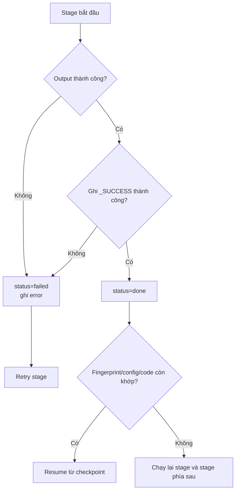

# Luồng dữ liệu từ upload đến kết quả

Tài liệu này mô tả dữ liệu đi qua hệ thống MasterOne từ lúc người dùng chọn file CRM/ERP/BILL cho đến khi kết quả được hiển thị trên giao diện.

## Tổng quan kiến trúc

```mermaid
flowchart LR
    U[Người dùng] --> FE[Frontend Next.js]

    FE -->|Xin presigned URL| API[Backend FastAPI]
    API -->|Trả signed URL| FE
    FE -->|Upload trực tiếp| IN[(Cloudflare R2\nincoming/)]
    FE -->|Danh sách object key + job_id| MERGE[POST /large-imports/merge]
    MERGE -->|Đọc streaming| IN
    MERGE -->|Ghi file đã merge| M[(R2\njobs/{job_id}/merged/)]
    MERGE -->|Ghi _SUCCESS| MS[(R2 manifest)]
    MERGE -->|Job/stage metadata| PG[(PostgreSQL\njobs, job_stages)]

    M --> N[Normalize / chuẩn hóa]
    N --> NP[(R2 Parquet\nnormalized/)]
    N -->|Metadata| PG
    NP --> X[Exact matching / resolution]
    X --> XP[(R2 Parquet\nmatching/)]
    X -->|Candidate pairs, status| PG
    XP --> R[Result / survivorship hiện có]
    R --> RP[(R2 Parquet\nresult/)]
    R -->|Kết quả nghiệp vụ| PG

    PG -->|GET overview, buckets, items| API
    RP --> API
    API --> FE
    FE --> UI[Dashboard kết quả\nreview / merge / export]
```

## Luồng chi tiết

### 1. Người dùng chọn file

Người dùng chọn tối đa các file CSV CRM, ERP và BILL trên frontend.

Frontend không nên gửi file lớn qua backend. Với luồng large-file, frontend gọi:

```text
POST /api/v1/large-imports/upload-url
```

Backend tạo object key dạng:

```text
incoming/{uuid}-{filename}.csv
```

Backend chỉ trả presigned `PUT URL`; nội dung file chưa đi qua FastAPI.

### 2. Frontend upload trực tiếp lên Cloudflare R2

Frontend dùng presigned URL để upload từng file:

```text
Browser ──PUT file──> Cloudflare R2
```

Sau khi upload xong, frontend gọi:

```text
POST /api/v1/large-imports/complete
```

Endpoint này xác nhận object key ở tầng API. File thật vẫn nằm trên R2.

### 3. Khởi tạo merge job

Frontend gửi danh sách object key tới:

```text
POST /api/v1/large-imports/merge
```

Backend:

1. Xác định hoặc tạo `job_id`.
2. Kiểm tra object input trên R2.
3. Tính fingerprint dựa trên object key, ETag và kích thước file.
4. Tạo/cập nhật metadata trong PostgreSQL:

```text
jobs
job_stages(stage = merge)
```

### 4. Merge streaming

Backend đọc lần lượt từng object CSV từ R2, không giữ toàn bộ file trong RAM:

```text
R2 incoming/CRM.csv
R2 incoming/ERP.csv
R2 incoming/BILL.csv
        │
        ▼
Đọc header thực tế của từng file
        │
        ▼
Tạo merged schema
        │
        ▼
Căn chỉnh từng row theo schema hợp nhất
        │
        ▼
R2 jobs/{job_id}/merged/merged.csv
```

Schema không bị cố định theo tên file. Các cột chung được đưa lên trước, các cột riêng được nối phía sau.

Sau khi output upload thành công, backend ghi:

```text
jobs/{job_id}/merge/_SUCCESS
```

Chỉ sau khi manifest ghi thành công, stage `merge` mới chuyển sang `done`.

File input trong `incoming/` được xóa nếu request có:

```json
{ "cleanup_sources": true }
```

### 5. Checkpoint normalize

Stage normalize đọc dữ liệu đã merge, chuẩn hóa các field nghiệp vụ và ghi checkpoint Parquet:

```text
jobs/{job_id}/normalized/part=0.parquet
jobs/{job_id}/normalized/_SUCCESS
```

PostgreSQL chỉ lưu metadata checkpoint, không lưu toàn bộ file lớn.

### 6. Exact matching / resolution

Stage matching đọc normalized checkpoint và chạy thuật toán hiện có. Kết quả candidate được ghi thành Parquet:

```text
jobs/{job_id}/matching/candidates.parquet
jobs/{job_id}/matching/_SUCCESS
```

PostgreSQL lưu trạng thái và metadata nghiệp vụ cần truy vấn. Các file trung gian lớn vẫn nằm trên R2.

### 7. Ghi kết quả

Kết quả hiện có được ghi tại:

```text
jobs/{job_id}/result/result.parquet
jobs/{job_id}/result/_SUCCESS
```

Nếu kết quả cần review hoặc hiển thị theo bucket, backend lưu các record nghiệp vụ tương ứng trong PostgreSQL.

### 8. Frontend hiển thị kết quả

Frontend gọi các API đọc dữ liệu:

```text
GET /api/v1/large-imports/jobs/{job_id}
GET /api/v1/mdm/runs/{run_id}/overview
GET /api/v1/mdm/runs/{run_id}/buckets/{bucket}
GET /api/v1/mdm/runs/{run_id}/items/{bucket}
```

Backend đọc metadata từ PostgreSQL và trả JSON nhỏ cho frontend. Frontend hiển thị:

- Tổng số bản ghi.
- Tiến độ từng stage.
- Số cặp tự động merge.
- Số cặp không merge.
- Hàng đợi cần review.
- Golden record/proposal.
- Lịch sử và file export.

Frontend polling trạng thái theo chu kỳ 2 giây và dừng khi job ở trạng thái terminal:

```text
COMPLETED
FAILED
RETRYABLE_FAILED
UPLOADED
```

## Nơi lưu dữ liệu

| Dữ liệu | Nơi lưu | Mục đích |
|---|---|---|
| File CSV gốc | R2 `incoming/` hoặc `jobs/{job_id}/raw/` | Input bất biến/tạm thời |
| File merged | R2 `jobs/{job_id}/merged/` | Output của stage merge |
| Normalized checkpoint | R2 `normalized/` | Input cho stage tiếp theo |
| Candidate pairs | R2 `matching/` và metadata PostgreSQL | Matching/review |
| Result checkpoint | R2 `result/` | Export và tải xuống |
| Job status | PostgreSQL `jobs` | Trạng thái job tổng thể |
| Stage status | PostgreSQL `job_stages` | Resume, retry, metrics |
| User/session | PostgreSQL | Authentication và ownership |
| File tạm | NVMe/local `WORK_DIR/{job_id}/` | Tốc độ cao, có thể tạo lại |

## Quy tắc hoàn tất stage

Một stage chỉ được coi là hoàn tất khi đồng thời thỏa mãn:

1. Output đã upload/ghi thành công.
2. Manifest `_SUCCESS` tồn tại.
3. Manifest chứa đúng fingerprint input.
4. `config_hash` và `code_version` khớp.
5. `job_stages.status = done`.

Nếu một điều kiện không khớp, stage phải chạy lại và các stage phía sau không được dùng checkpoint cũ.

## Hai entrypoint hiện có

Project hiện có hai luồng API:

### Large-file/R2 flow

```text
upload-url → R2 → complete → merge → R2 checkpoints → job status
```

Đây là luồng phù hợp cho file lớn và storage giữa các stage.

### Resolution run flow

```text
POST /api/v1/mdm/runs
→ backend nhận multipart
→ parse/standardize
→ PostgreSQL ResolutionRecord
→ start worker
→ blocking/matching/clustering/review
→ frontend overview/buckets/items
```

Luồng này vẫn đọc multipart vào bộ nhớ trước khi lưu record. Vì vậy R2 checkpoint không tự động biến toàn bộ resolution worker thành streaming pipeline; việc tối ưu RAM cho thuật toán resolution là một phạm vi riêng.

## Luồng lỗi và retry



