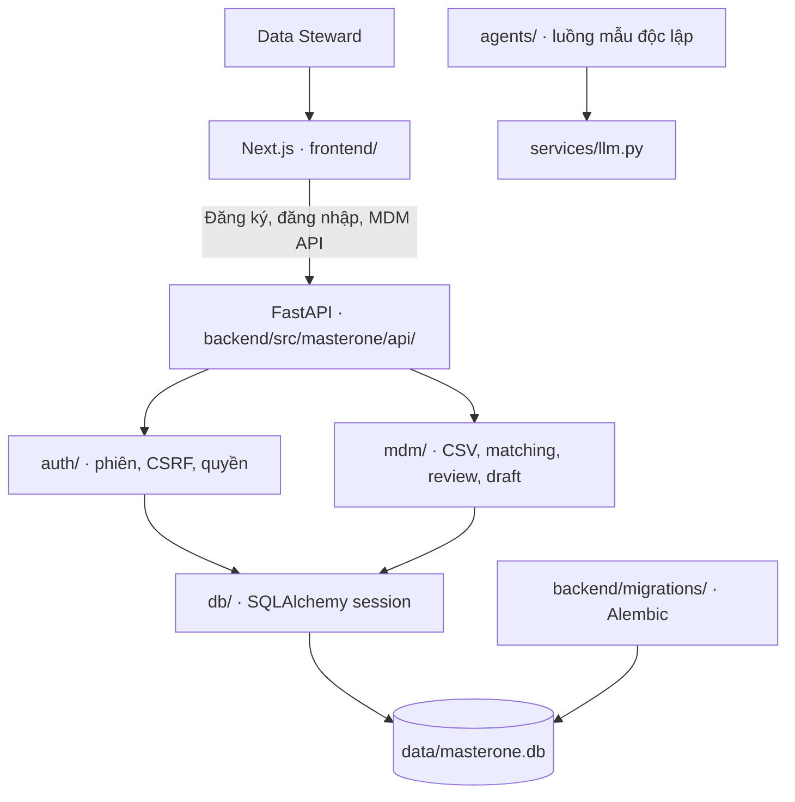

# Sơ đồ kiến trúc MasterOne

Các file CSV chỉ được giữ dưới dạng source records đã nhập. Matcher tạo candidate; quyết định của người duyệt và bản nháp Golden Record được lưu riêng. Frontend chỉ hiển thị import thuộc tài khoản đang đăng nhập; backend kiểm tra quyền trước khi trả dữ liệu.
