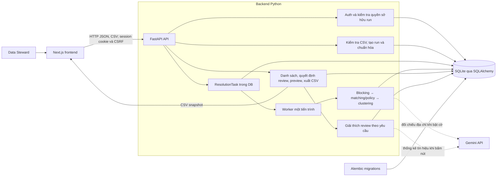
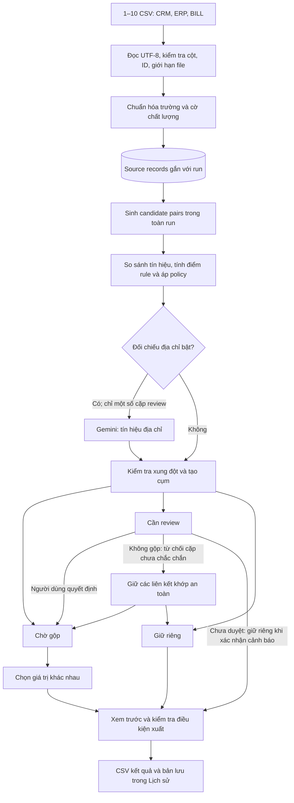

# Kiến trúc MasterOne MVP

Sơ đồ này mô tả ứng dụng đang chạy trong repo, không bao gồm LangGraph agent mẫu tại `backend/src/masterone/agents/`. MVP xử lý các bản ghi khách hàng `PERSON` trong **từng lần nạp (run) độc lập**.

## Components

Frontend ở `frontend/`; API, auth, worker và pipeline ở `backend/src/masterone/`. SQLite mặc định là `data/masterone.db`, không phải Supabase đang chạy. API chỉ trả run của chủ tài khoản. Các lựa chọn trường chưa xuất được giữ trong `localStorage` của trình duyệt; khi xem trước và xác nhận xuất, backend kiểm tra lại và lưu CSV snapshot trong database để tải từ Lịch sử.

## Luồng dữ liệu

**Ranh giới của pipeline:** dữ liệu được so khớp cả trong cùng file/nguồn lẫn giữa các file của một run; không so với các run cũ. `entity_id` trong dữ liệu đánh giá không đi vào quyết định. Matching và phân cụm chủ yếu là rule; điểm không phải xác suất đã hiệu chỉnh. Gemini giải thích khi người dùng yêu cầu, và đối chiếu địa chỉ chỉ khi `SEMANTIC_ADDRESS_ENABLED=true`; kết quả Gemini không tự tạo quyết định gộp.

**Đầu ra:** mỗi bản ghi nguồn xuất hiện đúng một lần trong CSV kết quả, có thể nằm trong cụm gộp hoặc được giữ riêng. Bản xem trước và bản xuất là hai bước riêng; nếu dữ liệu/quyết định thay đổi hoặc preview hết hạn thì cần tạo preview mới. Lịch sử lưu các CSV snapshot và hỗ trợ xem trước/sau, tải lại, và tách bản ghi từ một bản đã xuất.
