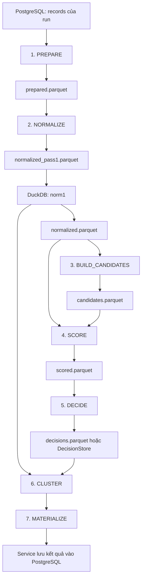
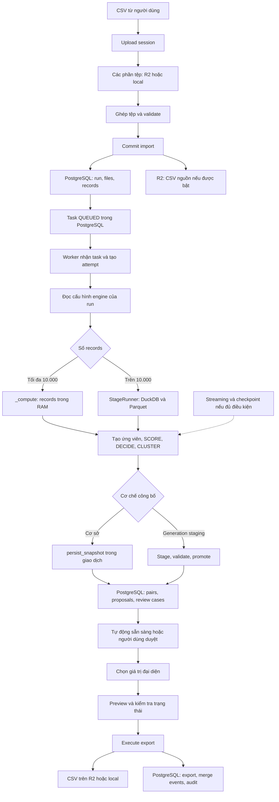

# 1. Phạm vi và mô hình hoạt động

Backend hiện tại thực hiện **phân giải thực thể** (*entity resolution*): xác định những bản ghi có khả năng cùng mô tả một người, hình thành nhóm bản ghi, chọn giá trị đại diện, tiếp nhận quyết định của người duyệt và xuất dữ liệu.

Ví dụ:

```text
CRM: Nguyễn Văn An, 0901234567
ERP: Nguyen Van An, +84901234567
```

Hai dòng có cách biểu diễn khác nhau nhưng có thể cùng thuộc một người. Hệ thống phải xác định điều đó dựa trên nhiều trường và các quy tắc kiểm soát.

Luồng chính hiện tại:

```text
Nhập CSV
→ Kiểm tra dữ liệu
→ Lưu bản ghi nguồn
→ Tạo tác vụ xử lý
→ Chuẩn bị và chuẩn hóa dữ liệu
→ Tìm các cặp cần so sánh
→ Chấm điểm
→ Áp dụng chính sách
→ Gom cụm và tạo giá trị đại diện
→ Lưu kết quả
→ Người dùng duyệt
→ Kiểm tra trước khi xuất
→ Tạo tệp xuất
```

**Phạm vi so sánh của luồng này là các bản ghi thuộc cùng một `run`.** Nạp một lượt CSV mới không có nghĩa backend tự động đối chiếu với toàn bộ khách hàng của mọi lượt nạp trước.

Giải thích dưới đây dựa trên mã nguồn hiện tại. Các tính năng bật bằng cấu hình được trình bày riêng; việc có mã nguồn không đồng nghĩa tính năng đang được bật trên môi trường triển khai.

---

# 2. Các thành phần và thuật ngữ

## 2.1. Thành phần thực thi

| Thành phần | Vai trò thực tế |
|---|---|
| Frontend | Tải CSV, theo dõi trạng thái, hiển thị kết quả, gửi quyết định duyệt và yêu cầu xuất |
| API backend | Xác thực yêu cầu, quản lý upload, đọc/ghi trạng thái nghiệp vụ, tạo tác vụ, xử lý duyệt và xuất |
| Resolution worker | Nhận tác vụ và chạy thuật toán phân giải |
| PostgreSQL | Lưu bản ghi nguồn, tác vụ, kết quả phân giải, quyết định duyệt, lịch sử và metadata của tệp |
| R2 | Lưu các đối tượng dạng tệp: phần upload, CSV nguồn, tệp xuất; có thể lưu thêm dữ liệu trung gian của tính năng tùy chọn |
| Ổ đĩa của tiến trình | Ghép CSV, lưu Parquet, DuckDB, SQLite và tệp xuất trong quá trình xử lý |
| RAM | Chứa batch đang xử lý và một số cấu trúc toàn cục như chỉ mục ứng viên, dữ liệu gom cụm |

Nếu triển khai PostgreSQL qua Supabase thì các bảng nghiệp vụ nói trên nằm trong PostgreSQL của Supabase. R2 vẫn là kho tệp riêng.

**API và worker là hai tiến trình riêng trong mã nguồn hiện tại.** Tạo tác vụ thành công chưa có nghĩa tác vụ sẽ được xử lý nếu không có worker nhận việc.

Worker có điểm chạy:

```bash
python -m masterone.mdm.resolution_worker
```

Nguồn: [resolution_worker.py](/D:/VinAI/P-119/backend/src/masterone/mdm/resolution_worker.py:137).

## 2.2. Các đối tượng nghiệp vụ

| Tên trong hệ thống | Ý nghĩa |
|---|---|
| `Upload session` | Phiên tải tệp tạm thời, trước khi dữ liệu được nhập chính thức |
| `Run` | Một lượt nạp và phân giải dữ liệu |
| `Record` | Một bản ghi nguồn, tương ứng một dòng dữ liệu CSV |
| `Task` | Công việc cần chạy để xử lý một run |
| `Attempt` | Một lần worker thực thi task; chạy lại tạo lần thực thi khác |
| `Candidate pair` | Cặp bản ghi được chọn để so sánh |
| `Blocking` | Kỹ thuật giảm số cặp phải so sánh bằng cách lập các nhóm có đặc điểm chung |
| `Evidence` | Bằng chứng so sánh từng trường: trùng số điện thoại, tên tương tự, ngày sinh khác nhau… |
| `Rule score` | Điểm tổng hợp theo quy tắc; không phải phần trăm xác suất |
| `Policy` | Bộ điều kiện quy định khi nào được tự động đề xuất gộp, khi nào cần duyệt |
| `Cluster` | Nhóm bản ghi được thuật toán gom lại |
| `Proposal` | Đề xuất gộp đã có danh sách thành viên và giá trị đại diện |
| `Golden record` | Bộ giá trị đại diện được chọn từ các bản ghi trong một nhóm |
| `Survivorship` | Quy tắc chọn giá trị nào được giữ làm giá trị đại diện |
| `Review case` | Hồ sơ chứa các cặp hoặc bản ghi cần người dùng xem xét |
| `Steward` | Người phụ trách kiểm tra và duyệt dữ liệu |
| `Lineage` | Thông tin truy ngược bản ghi về nguồn, tệp và dòng CSV |
| `Provenance` | Thông tin cho biết một trường hoặc kết quả được hình thành từ đâu |
| `Snapshot` | Bộ dữ liệu được xác định tại một thời điểm hoặc một lần xử lý |
| `Artifact` | Tệp do quá trình xử lý tạo ra, chẳng hạn `scored.parquet` |
| `Generation` | Một bộ kết quả tính toán được quản lý riêng trước khi công bố |
| `Checkpoint` | Kết quả trung gian đã được ghi nhận để có thể tái sử dụng khi chạy lại |
| `Materialize` | Chuyển kết quả tính toán thành dữ liệu có thể lưu và phục vụ truy vấn |

Hai thuật ngữ dễ nhầm:

- **Blocking**: tìm các cặp có khả năng liên quan.
- **Blocked / cannot-link**: cấm gộp do ràng buộc hoặc quyết định đã lưu.

---

# 3. Bộ dữ liệu minh họa xuyên suốt

Giả sử một lượt nạp gồm các bản ghi sau. `R1` đến `R5` là ký hiệu để giải thích; ID thật do backend tạo.

| Ký hiệu | Nguồn / ID nguồn | Tên | Điện thoại | Email |
|---|---|---|---|---|
| R1 | CRM / C01 | Nguyễn Văn An | 0901234567 | an@acme.vn |
| R2 | ERP / E08 | Nguyen Van An | +84901234567 | AN@ACME.VN |
| R3 | CRM / C02 | Trần Thị Bình | 0912345678 | Trống |
| R4 | BILL / B15 | Trần Thị Bình | +84912345678 | Trống |
| R5 | CSV / X05 | Lê Minh Châu | 0934567890 | chau@acme.vn |

Các trường còn lại:

| Ký hiệu | Ngày sinh | Địa chỉ |
|---|---|---|
| R1 | 15/03/1990 | 12 Lê Lợi, Hà Nội |
| R2 | 1990-03-15 | 12 Le Loi, Ha Noi |
| R3 | Trống | 25 Nguyễn Huệ, Đà Nẵng |
| R4 | Trống | 27 Nguyễn Huệ, Đà Nẵng |
| R5 | Trống | Cần Thơ |

Ý nghĩa nhãn nguồn:

- `CRM`: hệ thống quản lý khách hàng.
- `ERP`: hệ thống quản trị doanh nghiệp.
- `BILL`: hệ thống lập hóa đơn hoặc tính cước.
- `CSV`: nhãn nguồn được hợp đồng nhập liệu hỗ trợ.

Trong luồng này, chúng là **giá trị nguồn được ghi trong dữ liệu nhập**. Một dòng mang nhãn `CRM` không có nghĩa backend đang kết nối trực tiếp tới một phần mềm CRM.

Kịch bản minh họa:

```text
R1 + R2 → đủ điều kiện hình thành đề xuất tự động.
R3 + R4 → cần người dùng duyệt.
R5      → giữ riêng.
```

---

# 4. Nhập CSV: dữ liệu được lưu qua những bước nào?

## 4.1. Tạo phiên upload

Frontend tạo một `upload session`. Backend ghi metadata vào PostgreSQL:

```text
mdm_resolution_upload_sessions
mdm_resolution_upload_files
```

Metadata gồm thông tin phiên, người sở hữu, tệp, kích thước dự kiến và trạng thái.

Ở bước này:

```text
Có phiên upload.
Chưa có 5 bản ghi nguồn trong mdm_resolution_records.
Chưa có kết quả phân giải.
```

Mục đích của việc tách phiên upload khỏi run là cho phép tải, kiểm tra và sửa tệp trước khi nhập dữ liệu chính thức.

## 4.2. Tải tệp theo từng phần

Kích thước phần upload được quy định là **8 MiB**, phần cuối có thể nhỏ hơn.

Với mỗi phần:

```text
Bytes của phần tệp
→ R2 nếu đã cấu hình R2
→ hoặc thư mục staging cục bộ
```

Đường dẫn đối tượng R2 có dạng:

```text
upload-staging/{session_id}/{file_id}/{part_number}.part
```

Biên nhận phần upload được lưu trong:

```text
mdm_resolution_upload_parts
```

Biên nhận chứa thông tin như số thứ tự, kích thước, checksum và vị trí lưu.

**Checksum SHA-256** là giá trị băm dùng để đối chiếu nội dung, phát hiện phần tệp sai hoặc khác với nội dung đã ghi nhận.

## 4.3. Kiểm tra tệp

Backend ghép các phần thành tệp CSV trên ổ đĩa cục bộ để đọc và kiểm tra. Điều này vẫn xảy ra khi các phần upload nằm trên R2.

Các kiểm tra gồm:

- CSV có đọc được hay không.
- Các cột bắt buộc có tồn tại hay không.
- Dòng dữ liệu có đúng số cột hay không.
- Các trường bắt buộc có giá trị hay không.
- Nhãn nguồn có hợp lệ hay không.
- Có trùng định danh nguồn trong lượt nhập hay không.

Khóa định danh nguồn là:

```text
(source_system, source_record_id)
```

Ví dụ:

```text
CRM / C01 và ERP / C01 → được phép tồn tại đồng thời.
CRM / C01 xuất hiện hai lần → bị xem là trùng định danh nguồn.
```

Đây là kiểm tra **trùng khóa nguồn**. Việc hai dòng khác ID nhưng cùng mô tả Nguyễn Văn An được xử lý ở bước phân giải sau đó.

Quá trình kiểm tra sử dụng một chỉ mục SQLite tạm để phát hiện khóa nguồn trùng giữa các tệp. Sau kiểm tra, chỉ mục này được xóa.

Nếu hợp lệ:

```text
Upload session → READY
```

`READY` chỉ xác nhận tệp sẵn sàng nhập. Nó chưa xác nhận đã nhập dữ liệu và chưa xác nhận đã phân giải.

## 4.4. Commit: nhập dữ liệu chính thức

Khi commit phiên upload, backend:

1. Tạo `run`.
2. Tạo thông tin các tệp nguồn.
3. Đọc CSV theo dòng.
4. Ánh xạ tên cột về tên trường nội bộ.
5. Chuẩn hóa từng bản ghi.
6. Chèn bản ghi nguồn vào PostgreSQL.
7. Lưu CSV gốc lên R2 nếu có cấu hình.
8. Commit giao dịch cơ sở dữ liệu.
9. Đánh dấu phiên upload `COMMITTED`.
10. Dọn các phần upload tạm.

Các bảng chính:

```text
mdm_resolution_runs
mdm_resolution_files
mdm_resolution_records
```

Đường dẫn CSV gốc trên R2:

```text
uploads/{run_id}/{file_id}/{filename}
```

Backend chèn dữ liệu theo batch **1.000 bản ghi**. Tuy nhiên, mã hiện tại commit sau khi hoàn tất lượt nhập; **1.000 bản ghi là kích thước batch chèn, không phải một giao dịch độc lập**.

Sau khi nhập ví dụ:

```text
1 run
5 source records
Metadata của các tệp đã nhập
CSV gốc trên R2 nếu R2 được bật
```

Nếu không bật R2, bản ghi từng dòng vẫn nằm trong PostgreSQL, nhưng không nên coi các tệp upload tạm là bản lưu lâu dài của nguyên tệp CSV.

Nguồn: [upload_sessions.py](/D:/VinAI/P-119/backend/src/masterone/mdm/upload_sessions.py:317), [resolution_import.py](/D:/VinAI/P-119/backend/src/masterone/mdm/resolution_import.py:143).

---

# 5. Một bản ghi nguồn chứa gì và tại sao phải lưu nhiều dạng?

Với R2, bản ghi lưu trong `mdm_resolution_records` có các nhóm thông tin sau:

| Trường | Nội dung minh họa | Mục đích |
|---|---|---|
| `id` | ID nội bộ của R2 | Liên kết bản ghi với cặp, nhóm, quyết định |
| `external_id` | E08 | Giữ định danh từ hệ thống nguồn |
| `source_system` | ERP | Xác định nguồn dữ liệu |
| `run_id`, `file_id` | Lượt nhập và tệp chứa R2 | Phân vùng xử lý, truy vết |
| `original_fields` | Các tên cột và giá trị CSV ban đầu | Giữ dữ liệu dòng trước ánh xạ |
| `raw_fields` | `name`, `phone`, `email`… sau ánh xạ | Giữ giá trị nguồn dưới bộ tên trường thống nhất |
| `normalized_fields` | Giá trị đã chuẩn hóa | So sánh dữ liệu nhất quán |
| `mapping_provenance` | Cột CSV nào được ánh xạ vào trường nào | Giải thích quá trình ánh xạ |
| `lineage` | Tên tệp, số dòng, ID nguồn, hash tệp | Truy ngược kết quả về dữ liệu nhập |
| `quality_flags` | Các cờ chất lượng | Ghi nhận vấn đề dữ liệu |
| `extra_fields` | Các cột ngoài bộ trường chính | Giữ thông tin bổ sung |

Ví dụ giá trị trước và sau chuẩn hóa:

```json
{
  "raw_fields": {
    "name": "Nguyen Van An",
    "phone": "+84901234567",
    "email": "AN@ACME.VN",
    "dob": "1990-03-15"
  },
  "normalized_fields": {
    "name": "nguyen van an",
    "phone": "0901234567",
    "email": "an@acme.vn",
    "dob": "1990-03-15"
  }
}
```

Một số thay đổi điển hình:

| Dữ liệu nguồn | Dữ liệu chuẩn hóa |
|---|---|
| Nguyễn Văn An | nguyen van an |
| +84901234567 | 0901234567 |
| AN@ACME.VN | an@acme.vn |
| 15/03/1990 | 1990-03-15 |

Việc giữ cả dữ liệu nguồn và dữ liệu chuẩn hóa có mục đích cụ thể:

- Thuật toán sử dụng giá trị chuẩn hóa để so sánh.
- Giao diện và việc chọn giá trị xuất có thể cần nguyên văn giá trị nguồn.
- Người kiểm tra có thể xác định một kết luận đến từ dữ liệu gốc hay do bước chuẩn hóa.

**Chuẩn hóa không ghi đè giá trị nguồn.**

Ngoài ra, chất lượng `VALID` của điện thoại hoặc giấy tờ chủ yếu thể hiện điều kiện kiểm tra của hệ thống. Không được diễn giải thành “đã xác minh người sở hữu ngoài thực tế”.

Cấu trúc bảng: [models.py](/D:/VinAI/P-119/backend/src/masterone/mdm/models.py:109).

---

# 6. Tạo tác vụ và chọn đường xử lý

## 6.1. Tác vụ và lần thực thi

Khi bắt đầu phân giải:

```text
Run  → QUEUED
Task → QUEUED
```

Task được lưu trong:

```text
mdm_resolution_tasks
```

Worker lấy task và tạo lần thực thi trong:

```text
mdm_resolution_job_attempts
```

Một lần thực thi có:

- Worker đang sở hữu công việc.
- Thời gian bắt đầu.
- Heartbeat, tức tín hiệu tiến trình vẫn hoạt động.
- Lease, tức thời hạn được quyền xử lý công việc.
- Deadline.
- Trạng thái thành công hoặc thất bại.

Worker chạy pipeline trong tiến trình con và theo dõi tiến trình đó.

Mục đích là phát hiện trường hợp tiến trình chết, hết hạn, bị hủy hoặc mất quyền sở hữu; ngăn một tiến trình cũ tiếp tục ghi kết quả sau khi quyền xử lý đã thay đổi.

Hàng đợi ở đây sử dụng **PostgreSQL**.

## 6.2. Cấu hình engine được cố định theo run

Backend lưu lựa chọn engine vào:

```text
mdm_resolution_engine_selections
```

Lựa chọn này chứa các cờ quyết định cách xử lý run.

Do đó, khi đọc hành vi của một run đã có, cần xét cấu hình đã lưu cho run đó. Chỉ nhìn biến môi trường hiện tại chưa đủ để kết luận run đang dùng thuật toán nào.

## 6.3. Ngưỡng chọn đường xử lý

Trong `resolution_service.py`:

```python
if record_count > 10000:
    # StageRunner
else:
    # _compute với toàn bộ records trong RAM
```

Cụ thể:

| Số bản ghi trong run | Đường tính toán cơ sở |
|---|---|
| Tối đa 10.000 | Đọc các bản ghi vào bộ nhớ, gọi `_compute()` |
| Từ 10.001 | Gọi `StageRunner`, sử dụng DuckDB và các tệp Parquet trung gian |

**Ngưỡng này dựa trên số bản ghi đã nhập trong run**, không dựa trên số MB của tệp.

Streaming, checkpoint và công bố theo generation là các cơ chế khác được xét thêm theo cấu hình.

Nguồn: [resolution_service.py](/D:/VinAI/P-119/backend/src/masterone/mdm/resolution_service.py:129), [engine_adapter.py](/D:/VinAI/P-119/backend/src/masterone/mdm/engine_adapter.py:61).

---

# 7. Logic phân giải: từ bản ghi đến đề xuất gộp

Phần này mô tả nghiệp vụ chung. Phần tiếp theo mô tả chính xác cách nghiệp vụ đó được thực thi với dữ liệu lớn.

## 7.1. Tạo cặp ứng viên

Nếu so sánh mọi cặp trong 100.000 bản ghi:

```text
100.000 × 99.999 / 2 = 4.999.950.000 cặp
```

`CandidateEngine` giảm số cặp bằng cách tìm những bản ghi có đặc điểm chung.

Các cách tạo ứng viên hiện có gồm:

- Cùng số điện thoại hợp lệ.
- Cùng email hợp lệ.
- Cùng mã giấy tờ hợp lệ.
- Cùng tên đã chuẩn hóa.
- Có nhóm ký tự chung trong tên hoặc địa chỉ.
- Cùng một số khóa kết hợp như tên và năm sinh.
- Tìm tên tương tự bằng TF-IDF.

**TF-IDF** là cách biểu diễn văn bản bằng trọng số các thành phần xuất hiện trong văn bản, phục vụ tìm chuỗi gần nhau.

Một cặp có thể được tìm ra từ nhiều cách. Hệ thống hợp nhất chúng:

```json
{
  "left_id": "R1",
  "right_id": "R2",
  "reasons": [
    "exact_phone",
    "exact_email",
    "exact_name"
  ]
}
```

`reasons` giải thích **vì sao cặp được chọn để so sánh**, chưa phải kết luận gộp.

Trong ví dụ, R1–R2 và R3–R4 được chọn. Một số cặp khác cũng có thể được chọn do cùng các nhóm ký tự rồi bị loại ở bước quyết định.

Để hạn chế số cặp tăng quá lớn, engine có giới hạn kích thước block và số cặp. Block quá lớn có thể bị bỏ qua.

Hệ quả kỹ thuật: **candidate generation có thể bỏ sót cặp**. Đây là đánh đổi giữa chi phí tính toán và khả năng tìm đủ các trường hợp trùng.

## 7.2. So sánh từng trường

Với mỗi cặp, backend tạo bằng chứng cho từng trường.

Các trạng thái thường gặp:

| Mã | Ý nghĩa |
|---|---|
| `EX` | Trùng theo phép so sánh chính xác của trường |
| `NX` | Trùng sau chuẩn hóa |
| `NA` | Tên trùng sau biến đổi về dạng ASCII |
| `HS` | Tương đồng cao |
| `MS` | Tương đồng trung bình |
| `MI` | Thiếu dữ liệu |
| `CF` | Xung đột |
| `DF` | Khác nhau; cách diễn giải phụ thuộc trường |

Với R1–R2:

```text
Tên        → tương đương sau bỏ dấu
Điện thoại → trùng sau chuẩn hóa
Email      → trùng sau chuẩn hóa
Ngày sinh  → trùng
Địa chỉ    → trùng sau chuẩn hóa
```

Với R3–R4:

```text
Tên        → trùng
Điện thoại → trùng sau chuẩn hóa
Email      → thiếu
Ngày sinh  → thiếu
Địa chỉ    → tương tự nhưng khác số nhà
```

`field_evidence` giữ kết quả này để giải thích quyết định và phục vụ người duyệt.

## 7.3. Chấm điểm

Engine cộng điểm từ các bằng chứng.

Điện thoại và email trùng có trọng số phụ thuộc tần suất xuất hiện trên toàn bộ snapshot:

```text
trọng số = max(1, 5 − log2(tần suất))
```

Một số liên lạc xuất hiện ở nhiều bản ghi cung cấp ít thông tin phân biệt hơn số chỉ xuất hiện ở hai bản ghi.

Với bộ năm dòng trên và cấu hình cơ sở, ví dụ R1–R2 có:

| Bằng chứng | Điểm |
|---|---:|
| Tên tương đương sau bỏ dấu | 1,8 |
| Điện thoại trùng, tần suất 2 | 4,0 |
| Email trùng, tần suất 2 | 4,0 |
| Ngày sinh trùng | 1,5 |
| Địa chỉ trùng sau chuẩn hóa | 0,7 |
| **Tổng** | **12,0** |

R3–R4 có:

| Bằng chứng | Điểm |
|---|---:|
| Tên trùng | 2,0 |
| Điện thoại trùng, tần suất 2 | 4,0 |
| Địa chỉ tương đồng cao | 0,5 |
| **Tổng** | **6,5** |

Điểm có thể thay đổi khi thêm dữ liệu vì tần suất toàn bộ tập thay đổi.

**12,0 là điểm quy tắc, không phải xác suất 12% hay 100%.**

## 7.4. Áp dụng chính sách

Điểm chỉ là một đầu vào. Backend còn kiểm tra:

- Các trường bắt buộc phải khớp.
- Chất lượng của trường.
- Trường hợp xung đột.
- Giá trị liên lạc dùng chung.
- Ràng buộc cấm gộp.
- Điều kiện của từng policy.

Các policy tự động tiêu biểu:

| Policy | Nhóm điều kiện chính | Điểm tối thiểu |
|---|---|---:|
| A1 | Tên phù hợp và điện thoại hợp lệ trùng | 10,5 |
| A2 | Tên phù hợp và email hợp lệ trùng | 10,5 |
| A3 | Điện thoại trùng, ngày sinh trùng, tên phù hợp theo điều kiện riêng | 12,0 |

Các kết quả thường gặp:

| Kết quả | Ý nghĩa |
|---|---|
| `MERGEABLE` | Cặp đủ điều kiện để xét gộp tự động |
| `REVIEW` | Cần người kiểm tra |
| `NOT_MERGEABLE` / `BLOCKED` | Không được gộp theo ràng buộc hiện tại |
| `INSUFFICIENT_EVIDENCE` | Thiếu bằng chứng nhận dạng |

Trong ví dụ:

```text
R1–R2: 12,0 → MERGEABLE
R3–R4:  6,5 → REVIEW
```

Các cặp `INSUFFICIENT_EVIDENCE` bị loại khỏi danh sách cặp phục vụ kết quả; run vẫn ghi nhận số lượng bị loại.

### Ý nghĩa nhóm A, C, D

Các nhóm này mô tả dạng bằng chứng:

| Nhóm | Ý nghĩa khái quát |
|---|---|
| A | Có bằng chứng nhận dạng mạnh, không có xung đột thuộc nhánh phân loại đó |
| C | Thiếu bằng chứng nhận dạng cần thiết |
| D | Có xung đột cần xem xét |

**Nhóm A vẫn có thể cần duyệt.** R3–R4 có tên và điện thoại trùng, nhưng thiếu bằng chứng để đạt ngưỡng tự động.

`subgroup`, chẳng hạn `A1_NAME_PHONE`, mô tả dạng cặp. `policy_id` cho biết chính sách quyết định được áp dụng. Hai trường có vai trò khác nhau và không nhất thiết phải có cùng hậu tố.

Nguồn: [candidate_engine.py](/D:/VinAI/P-119/backend/src/masterone/mdm/pipeline/candidate_engine.py:79), [policy_person_v3.yaml](/D:/VinAI/P-119/backend/src/masterone/mdm/config/policy_person_v3.yaml:39).

## 7.5. Gom cụm

Kết luận từng cặp chưa đủ để hình thành nhóm an toàn.

Ví dụ:

```text
A–B đủ điều kiện gộp.
B–C đủ điều kiện gộp.
A–C có ràng buộc cấm gộp.
```

Nếu chỉ nối hai cạnh đầu tiên, cả ba bản ghi sẽ vào một nhóm sai.

Backend sử dụng cơ chế hợp nhất nhóm và kiểm tra ràng buộc trước khi nối nhóm. Các cạnh được xét theo thứ tự xác định, ưu tiên trọng số cao.

Các kiểm soát gồm giới hạn kích thước nhóm, xung đột, liên kết cấm và các điều kiện an toàn của cấu hình đang dùng.

Kết quả ví dụ:

```text
Proposal P_AN:
    members = [R1, R2]
    status  = AUTO_READY

Review case C_BINH:
    pair    = R3–R4
    status  = OPEN

R5:
    Không nằm trong proposal.
    Vẫn được giữ trong bảng records.
```

`AUTO_READY` có nghĩa nhóm đã sẵn sàng cho luồng xuất. Các dòng nguồn R1 và R2 vẫn tồn tại.

## 7.6. Tạo golden record

Với nhóm R1–R2, backend chọn giá trị đại diện từng trường.

Ở nhánh cơ sở, việc chọn trường đơn xét chất lượng trước, sau đó độ ưu tiên nguồn và yếu tố thời gian/khóa phụ. Thứ tự nguồn được khai báo:

```text
CRM > ERP > BILL
```

Điện thoại và email có thể giữ danh sách giá trị phù hợp đã loại trùng, đồng thời có một giá trị chính.

Ví dụ:

```json
{
  "member_record_ids": ["R1", "R2"],
  "fields": {
    "name": {
      "value": "Nguyễn Văn An",
      "source_record_id": "R1",
      "source_system": "CRM",
      "provenance": "SURVIVORSHIP"
    },
    "phone": {
      "value": "0901234567",
      "provenance": "SURVIVORSHIP"
    }
  }
}
```

Golden được lưu cùng proposal để:

- Hiển thị giá trị đại diện.
- Giải thích nguồn của giá trị.
- Cho phép điều chỉnh.
- Làm đầu vào xuất dữ liệu.

Nguồn: [clustering.py](/D:/VinAI/P-119/backend/src/masterone/mdm/pipeline/clustering.py:10), [golden.py](/D:/VinAI/P-119/backend/src/masterone/mdm/pipeline/golden.py:47).

---

# 8. Đường xử lý dữ liệu lớn: chi tiết từng giai đoạn

Giả sử run có **100.000 bản ghi**, trong đó chứa R1–R5 cùng 99.995 bản ghi khác.

Backend chọn `StageRunner` vì:

```text
100.000 > 10.000
```

Không được mặc định điểm của R1–R5 giữ nguyên khi mở rộng tập dữ liệu. Tần suất liên lạc và tập ứng viên sẽ được tính lại trên 100.000 bản ghi.

Sơ đồ nhánh cơ sở, khi không đi vào streaming tùy chọn:



**Các tệp trong sơ đồ này mặc định nằm trên ổ đĩa của tiến trình xử lý.** Việc cấu hình R2 không tự động chuyển toàn bộ scratch file của `StageRunner` lên R2.

## 8.1. PREPARE: tạo snapshot phục vụ xử lý

**Đầu vào:** các bản ghi thuộc run trong PostgreSQL.

`StageRunner` tạo một cơ sở dữ liệu DuckDB cục bộ rồi sử dụng extension PostgreSQL của DuckDB để đọc dữ liệu.

Các trường được lấy gồm:

```text
id
external_id
source_system
entity_type
raw_fields
normalized_fields
quality_flags
source_updated_at
```

**Đầu ra:**

```text
{run_id}_prepared.parquet
```

Parquet là định dạng dữ liệu theo cột, phù hợp cho việc đọc từng phần và phân tích dữ liệu.

Mục đích:

- Đưa dữ liệu cần tính toán về máy chạy worker.
- Tạo đầu vào chung cho các giai đoạn tiếp theo.
- Giảm việc truy vấn PostgreSQL từ xa trong từng phép so sánh cặp.

PostgreSQL vẫn giữ dữ liệu nguồn. Tệp Parquet này là bản làm việc phục vụ tính toán.

## 8.2. NORMALIZE: bảo đảm có trường chuẩn hóa

Backend đọc `prepared.parquet` theo batch **50.000 dòng**.

Điểm cần phân biệt với tên giai đoạn:

> Với bản ghi được nhập bằng luồng hiện tại, `normalized_fields` thường đã được tạo ở bước import. StageRunner giữ lại giá trị đó.

Chỉ bản ghi chưa có trường chuẩn hóa mới gọi hàm chuẩn hóa.

**Dữ liệu trung gian:**

```text
normalized_pass1.parquet
DuckDB TEMP TABLE norm1
normalized.parquet
```

Trong mã có chú thích về bước tổng hợp `SHARED`, nhưng đoạn thực thi hiện tại ở đây chủ yếu tạo `norm1` rồi sao chép ra Parquet. Không có cơ sở để nói riêng giai đoạn này đã thực hiện đầy đủ một lượt tổng hợp toàn cục để gán `SHARED`.

Mục đích thực tế là tạo dữ liệu có cấu trúc thống nhất cho các bước sau.

## 8.3. BUILD_CANDIDATES: dựng chỉ mục và tập cặp

Backend đọc `normalized.parquet` theo batch rồi gọi:

```text
CandidateEngine.add_records(...)
```

Sau khi đọc đủ dữ liệu:

```text
CandidateEngine.finalize()
```

Đặc điểm quan trọng: **chỉ mục là toàn cục**.

Nếu R1 nằm trong batch đầu, R2 nằm trong batch cuối, chúng vẫn có thể được ghép thành ứng viên. Ranh giới batch không chia tập dữ liệu thành những miền so sánh độc lập.

**Đầu ra:**

```text
{run_id}_candidates.parquet
{run_id}_candidates.metrics.json
{run_id}_candidates.blocks.json
```

Mỗi dòng Parquet chứa một cặp duy nhất:

```text
left_id | right_id | reasons
```

Các tệp JSON ghi thông tin số lượng và hành vi tạo block.

**Giới hạn bộ nhớ:** engine vẫn giữ chỉ mục và tập cặp toàn cục trong RAM. Quá trình tạo bảng ứng viên để ghi Parquet cũng tạo cấu trúc dữ liệu trong bộ nhớ.

Do đó, đọc theo batch ở đầu vào không đồng nghĩa bước này có mức dùng RAM cố định.

## 8.4. SCORE: chấm điểm từng batch ứng viên

`ScoringEngine` dùng:

```text
candidates.parquet
+
normalized.parquet
```

Trước khi chấm, engine quét snapshot để tính thống kê toàn cục và định danh dữ liệu đầu vào.

Sau đó, với mỗi batch mặc định **2.048 cặp**:

1. Đọc ID của các cặp.
2. Lấy dữ liệu của những bản ghi xuất hiện trong batch.
3. So sánh trường.
4. Tính điểm.
5. Ghi kết quả.

Bước lấy dữ liệu bản ghi theo ID được gọi là **hydration** trong mã.

**Đầu ra:**

```text
{run_id}_scored.parquet
Metadata về cấu hình, snapshot, checksum và số lượng
```

Trong lúc ghi, engine sử dụng:

- Tệp Parquet tạm.
- SQLite làm sổ kiểm tra tính duy nhất và độ bao phủ của các cặp.

Một điều kiện cần đạt là mỗi cặp ứng viên được chấm đúng một lần. Sau khi kiểm tra thành công, tệp tạm được đổi thành tệp kết quả.

Mục đích của sổ SQLite là thực hiện kiểm tra số lượng lớn mà không cần giữ thêm một Python set chứa toàn bộ cặp đã ghi.

### Chạy SCORE song song

Ngưỡng mặc định:

```text
15.000 cặp ứng viên
```

Các biến điều khiển:

```text
MDM_SCORE_PARALLEL_MIN
MDM_SCORE_WORKERS
```

Số tiến trình mặc định không vượt quá bốn và phụ thuộc số CPU được nhận diện.

Điều kiện còn phụ thuộc chế độ chấm điểm; nhánh song song này phục vụ rule mode.

Phân biệt hai ngưỡng:

| Ngưỡng | Đơn vị | Mục đích |
|---|---|---|
| Hơn 10.000 | Bản ghi nguồn | Chọn StageRunner |
| Từ 15.000 mặc định | Cặp ứng viên | Cho phép SCORE/DECIDE chạy nhiều tiến trình khi đủ điều kiện |

Một run dưới 10.001 bản ghi vẫn có thể tạo rất nhiều cặp và sử dụng SCORE song song.

## 8.5. DECIDE: chuyển điểm thành kết luận

Backend đọc kết quả SCORE theo batch và áp dụng chính sách.

Mỗi cặp có thể trở thành:

```text
MERGEABLE
REVIEW
NOT_MERGEABLE
INSUFFICIENT_EVIDENCE
...
```

Cặp thiếu bằng chứng bị loại khỏi tập kết quả cần lưu phục vụ duyệt. Backend vẫn tăng bộ đếm `insufficient_count`.

Cặp được giữ lại có ID hình thành từ các thành phần:

```text
run_id
left_record_id
right_record_id
policy_version
```

**Đầu ra cơ sở:**

```text
{run_id}_decisions.parquet
```

Trong nhánh cơ sở, các quyết định được giữ trong danh sách bộ nhớ, ghi Parquet rồi đọc lại để phục vụ gom cụm.

Khi bật cluster safety v2 và không dùng semantic address enrichment, backend có thể dùng `DecisionStore` trên đĩa để giảm việc giữ toàn bộ quyết định trong danh sách Python.

DECIDE của StageRunner cũng có thể chạy song song theo các điều kiện số cặp và số worker nêu trên. Kết quả được thu theo thứ tự đầu vào, tránh việc thứ tự hoàn thành ngẫu nhiên của tiến trình làm thay đổi luồng xử lý.

## 8.6. CLUSTER: gom nhóm trên toàn bộ dữ liệu

Giai đoạn này cần xét quan hệ giữa nhiều cặp.

Backend đọc dữ liệu từ `norm1` theo từng lượt **2.048 dòng**, nhưng tích lũy chúng vào:

```python
by_id_full
```

Sau đó gọi:

```python
build_proposals(...)
```

Kết quả gồm:

```text
proposals
golden_fields
review_cases
```

**Đây là một điểm dùng RAM đáng kể.** Việc đọc `fetchmany(2048)` chỉ giới hạn mỗi lần lấy dữ liệu; toàn bộ bản ghi vẫn được tập hợp để gom cụm.

Một cặp `MERGEABLE` có thể bị chuyển sang luồng duyệt ở bước gom cụm nếu việc nối nhóm gây xung đột.

## 8.7. MATERIALIZE: chuẩn bị và công bố kết quả

`StageRunner` tập hợp:

```text
pairs
proposals
review_cases
candidate_count
insufficient_count
metrics
```

Trong đường gọi hiện tại từ `resolution_service.py`:

```python
return_data=True
```

Vì vậy, **service nhận kết quả từ StageRunner rồi mới thực hiện ghi PostgreSQL**.

Các bảng phục vụ nghiệp vụ:

```text
mdm_resolution_pairs
mdm_resolution_proposals
mdm_resolution_review_cases
```

Sau khi ghi thành công:

```text
Task → COMPLETED
Run  → COMPLETED
```

`COMPLETED` ở đây nghĩa là **pipeline tính toán đã hoàn tất**. Các hồ sơ cần người duyệt vẫn có thể đang mở.

### Kết luận về khả năng xử lý dữ liệu lớn

Nhánh này đã có:

- Snapshot Parquet.
- Truy vấn cục bộ bằng DuckDB.
- Chấm điểm theo batch.
- SCORE/DECIDE song song.
- Kiểm tra số lượng và tính duy nhất trên đĩa.

Nhưng vẫn có:

- Chỉ mục ứng viên toàn cục trong RAM.
- Tập cặp ứng viên trong RAM.
- Dữ liệu toàn bộ bản ghi trong bước gom cụm.
- Danh sách quyết định trong một số cấu hình.

Vì vậy, đây là **nhánh tối ưu cho dữ liệu lớn hơn**, chưa phải thiết kế bảo đảm xử lý kích thước bất kỳ với lượng RAM cố định. Không thể suy ra một máy 512 MB sẽ xử lý được 100.000 dòng chỉ từ việc nhánh này tồn tại.

Nguồn: [stage_runner.py](/D:/VinAI/P-119/backend/src/masterone/mdm/pipeline/stage_runner.py:163), [scoring_engine.py](/D:/VinAI/P-119/backend/src/masterone/mdm/pipeline/scoring_engine.py:351).

---

# 9. Streaming, generation staging và checkpoint

Ba cơ chế này giải quyết ba vấn đề khác nhau.

## 9.1. Streaming: truyền các phần dữ liệu giữa giai đoạn

Các cờ cấu hình:

```text
stream_prepare_normalize_enabled
stream_normalize_build_enabled
stream_build_score_enabled
stream_score_decide_enabled
stream_decide_materialize_enabled
```

Ý tưởng thực thi:

```text
Một phần dữ liệu hoàn tất
→ Ghi thành artifact
→ Gửi tham chiếu artifact cho bước tiêu thụ
→ Tiếp tục tạo phần kế tiếp khi ngân sách cho phép
```

**Partition** là một phần dữ liệu. Kích thước mặc định ở cơ chế này là 512 dòng.

Hàng đợi có giới hạn số phần và số byte đang được xử lý. Khi phần sau chưa tiêu thụ kịp, phần trước phải chờ. Đây là cơ chế **backpressure**, nhằm hạn chế dữ liệu tồn đọng.

Tuy nhiên, mã hiện tại vẫn có các điểm phải đợi toàn bộ tập:

```text
Hoàn thành snapshot chuẩn hóa
→ Tính thống kê toàn cục

Hoàn thành chỉ mục ứng viên
→ Chốt tập cặp toàn cục

Hoàn thành các kiểm tra kết quả
→ Gom cụm và công bố
```

Trong `compute_scores()`, các bản ghi chuẩn hóa vẫn được tập hợp lại trong bộ nhớ. Streaming này chưa loại bỏ yêu cầu bộ nhớ toàn cục.

Nếu thiếu điều kiện, backend quay về đường xử lý tuần tự, ví dụ:

- Không bật streaming/resume.
- Đang bật semantic address.
- Dùng chế độ chấm khác rule.
- Không có kho lưu artifact phù hợp.

Nguồn: [streaming.py](/D:/VinAI/P-119/backend/src/masterone/mdm/pipeline/streaming.py).

## 9.2. Generation staging: ghi kết quả riêng trước khi công bố

Vấn đề cần giải quyết là tránh để giao diện thấy một bộ kết quả đang ghi dở.

Luồng:

```text
Tạo generation
→ Tính toán
→ Ghi các phần kết quả vào vùng staging
→ Kiểm tra số lượng, checksum và tham chiếu
→ Kiểm tra đầu vào/quyết định người dùng chưa thay đổi
→ Promote: công bố kết quả
```

Các bảng liên quan:

```text
mdm_resolution_generations
mdm_resolution_generation_attempts
mdm_resolution_staged_results
mdm_resolution_partition_receipts
mdm_resolution_publications
```

`publication` ghi nhận generation đã được công bố.

Tại bước promote, backend vẫn ghi các kết quả vào những bảng phục vụ nghiệp vụ như pairs, proposals và review cases trong giao dịch được kiểm soát.

Mục đích:

- Không công bố kết quả chưa hoàn tất.
- Chặn lần thực thi cũ ghi đè trạng thái mới.
- Kiểm tra dữ liệu đầu vào và quyết định duyệt có thay đổi hay không.

Ngay cả đường lưu cơ sở cũng có logic giữ lại quyết định người dùng và các đối tượng đã tồn tại khi chạy lại; không đơn giản xóa hết rồi chèn lại.

## 9.3. Checkpoint: tái sử dụng kết quả khi chạy lại

Khi bật:

```text
pipeline_resume_enabled
```

Backend có thể lưu checkpoint và các quan hệ phụ thuộc.

Ví dụ:

```text
PREPARE đã hoàn thành.
NORMALIZE đã hoàn thành.
Một số phần SCORE đã hoàn thành.
Tiến trình dừng.
```

Lần sau có thể tái sử dụng kết quả phù hợp nếu kiểm tra cho thấy:

- Đầu vào tương thích.
- Cấu hình và phiên bản xử lý tương thích.
- Artifact còn tồn tại.
- Checksum và phụ thuộc hợp lệ.

Các bảng:

```text
mdm_checkpoints
mdm_checkpoint_dependencies
mdm_checkpoint_objects
```

Artifact có thể dùng R2; cơ chế checkpoint cũng có kho dự phòng lưu đối tượng trong PostgreSQL.

**Retry** và **resume** khác nhau:

```text
Retry  → thực thi lại tác vụ.
Resume → tái sử dụng kết quả đã kiểm tra để giảm phần phải tính lại.
```

Một thư mục Parquet tạm tồn tại trên máy không tự trở thành checkpoint hợp lệ.

## 9.4. Trạng thái bật/tắt

Mặc định trong `config.py`, các cờ v2, streaming và resume nêu trên đều là `False`.

Khi bật `mdm_engine_v2_enabled`, engine có thể chọn bộ ba:

```text
decision_semantics_v2
cluster_safety_v2
generation_staging
```

cho run phù hợp. Cờ này **không tự bật tất cả streaming và resume**.

Trong v2:

- Logic quyết định phân biệt rõ bằng chứng, quyền được gộp và quyết định người duyệt.
- Các xung đột định danh có xét metadata xác minh.
- Cluster safety kiểm tra tính nhất quán của cả nhóm, kể cả quan hệ chưa xuất hiện thành cặp ứng viên.
- Golden selection dùng triển khai v2.
- Kết quả được công bố qua generation.

Nguồn: [generation_staging.py](/D:/VinAI/P-119/backend/src/masterone/mdm/generation_staging.py:519), [checkpoints.py](/D:/VinAI/P-119/backend/src/masterone/mdm/pipeline/checkpoints.py:147).

---

# 10. Duyệt: quyết định của người dùng thay đổi dữ liệu nào?

Quay lại ví dụ năm bản ghi, sau pipeline:

| Đối tượng | Trạng thái |
|---|---|
| R1–R5 | Vẫn nằm trong bảng records |
| Cặp R1–R2 | Có kết quả tự động |
| Proposal R1–R2 | `AUTO_READY` |
| Cặp R3–R4 | Cần duyệt |
| Review case R3–R4 | `OPEN` |
| R5 | Chưa thuộc nhóm gộp |

Luồng giao diện hiện tại dùng duyệt theo cặp.

## 10.1. Người dùng chấp nhận R3–R4

Backend:

1. Khóa run và cặp đang duyệt.
2. Kiểm tra revision.
3. Kiểm tra run đã xử lý xong.
4. Kiểm tra cặp chưa được xử lý hoặc bị cấm.
5. Xác định các proposal liên quan.
6. Mở rộng tập thành viên nếu cần hợp nhất cả nhóm.
7. Kiểm tra ràng buộc của tập thành viên.
8. Tạo proposal mới.
9. Cập nhật cặp và review case.
10. Ghi audit event.
11. Commit.

Kết quả đơn giản trong ví dụ:

```text
R3–R4.user_decision = ACCEPTED

Proposal P_BINH:
    member_record_ids = [R3, R4]
    status = REVIEW_APPROVED
    origin = REVIEW
```

Nếu đã có proposal cũ bị thay thế, proposal đó được chuyển sang `SUPERSEDED`.

Số bản ghi nguồn vẫn là năm.

## 10.2. Người dùng từ chối gộp

Kết quả:

```text
R3–R4.user_decision = REJECTED
```

Nếu cặp nằm trong một proposal đang hợp lệ, backend xử lý tách proposal liên quan thành các phần phù hợp.

Quyết định `REJECTED` được dùng để ngăn gộp trong các bước liên quan. Tuy nhiên, trong mô hình v2, nó không tự động trở thành bằng chứng tuyệt đối rằng hai bản ghi chắc chắn là hai người khác nhau. Mô hình có sự phân biệt giữa từ chối thao tác gộp và kết luận nhận dạng `NON_MATCH`.

## 10.3. Revision dùng để làm gì?

Giả sử hai người cùng mở cặp ở revision 1.

```text
Người A duyệt → revision tăng lên 2.
Người B gửi quyết định dựa trên revision 1.
```

Backend từ chối yêu cầu lỗi thời, yêu cầu tải lại.

Mục đích là tránh quyết định sau ghi đè một thay đổi mà người duyệt chưa nhìn thấy.

## 10.4. Chọn giá trị trường khác với chấp nhận gộp

Đối với Bình:

```text
R3.address = 25 Nguyễn Huệ, Đà Nẵng
R4.address = 27 Nguyễn Huệ, Đà Nẵng
```

Chấp nhận R3–R4 xác nhận hai bản ghi được phép nằm trong cùng proposal.

Sau đó vẫn cần xác định giá trị địa chỉ sẽ xuất.

Hệ thống có hai dạng thao tác:

| Thao tác | Nơi lưu |
|---|---|
| Sửa trực tiếp golden của proposal | PostgreSQL, trong golden override của proposal, kèm revision/audit |
| Chọn bản ghi nguồn cung cấp trường cho lần xuất | Ban đầu ở trạng thái frontend/localStorage; khi tạo preview được gửi và lưu trong PostgreSQL |

Ví dụ chọn:

```text
Tên: từ R3
Điện thoại: từ R3
Địa chỉ: từ R4
```

Các lựa chọn này không thay đổi dữ liệu nguồn của R3 hoặc R4.

Nguồn: [resolution_pairs.py](/D:/VinAI/P-119/backend/src/masterone/mdm/resolution_pairs.py:38).

---

# 11. Xuất dữ liệu: từ proposal đến tệp CSV

## 11.1. Tạo preview

Preview là bản ghi mô tả một phương án xuất đã được kiểm tra. Ở bước này backend chưa cần tạo toàn bộ CSV.

Backend kiểm tra:

- Run đã `COMPLETED`.
- Các proposal có chồng lấn thành viên không.
- Có lựa chọn trường còn thiếu không.
- Có xung đột cần xử lý không.
- Có vi phạm quyết định cấm gộp không.
- Có bản ghi chưa duyệt cần người dùng xác nhận xuất riêng không.

Sau đó lưu:

```text
mdm_resolution_previews
```

Preview chứa:

```text
Các lựa chọn trường
Revision của proposal
Hash trạng thái các cặp
Policy version
Người tạo
Thời hạn
```

Thời hạn hiện tại là **15 phút**.

Mục đích là ràng buộc thao tác xuất với đúng trạng thái người dùng đã kiểm tra.

## 11.2. Thực hiện preview

Khi execute:

1. Khóa run.
2. Kiểm tra người thực hiện.
3. Kiểm tra preview còn hạn.
4. Kiểm tra proposal và cặp chưa thay đổi.
5. Kiểm tra lại ràng buộc.
6. Tạo bản xuất.
7. Ghi lịch sử gộp và audit.
8. Đánh dấu preview `EXECUTED`.

Yêu cầu có ID để kiểm soát việc gửi lặp. Thực hiện lại cùng yêu cầu đã hoàn tất có thể trả về kết quả đã tạo thay vì tạo thêm một bản xuất khác.

## 11.3. Quy tắc chuyển bản ghi nguồn thành dòng xuất

Hai trạng thái proposal được lấy để xuất gộp:

```text
AUTO_READY
REVIEW_APPROVED
```

Mỗi proposal hợp lệ tạo **một dòng xuất**.

Mỗi bản ghi nguồn chưa nằm trong proposal xuất được tạo **một dòng riêng**.

Trong ví dụ, sau khi duyệt Bình:

```text
R1 + R2 → một dòng An
R3 + R4 → một dòng Bình
R5      → một dòng Châu
```

Kết quả:

```text
5 bản ghi nguồn → 3 dòng CSV
```

## 11.4. Thứ tự chọn giá trị xuất

Với từng trường, thứ tự ưu tiên là:

```text
Golden override đã lưu
→ Lựa chọn nguồn gửi trong yêu cầu xuất
→ Giá trị golden của proposal
→ Giá trị nguồn dự phòng
```

Nếu người dùng chọn địa chỉ của R4, dòng Bình sẽ có:

```text
27 Nguyễn Huệ, Đà Nẵng
```

Việc chọn giá trị từ nguồn có thể lấy nguyên văn `raw_fields`. Vì vậy, chuẩn hóa phục vụ matching không đồng nghĩa mọi giá trị xuất đều được chuyển sang dạng normalized.

## 11.5. Những cột CSV thực tế

Tệp xuất chuẩn hiện tại gồm:

```text
master_record_id
full_name
phone_number
email_address
raw_address
source_record_ids
source_systems
record_count
resolution_status
review_pending
```

Minh họa các cột chính:

| full_name | phone_number | raw_address | source_record_ids | source_systems | record_count | resolution_status |
|---|---|---|---|---|---:|---|
| Nguyễn Văn An | 0901234567 | 12 Lê Lợi, Hà Nội | C01\|E08 | CRM\|ERP | 2 | MERGED |
| Trần Thị Bình | 0912345678 | 27 Nguyễn Huệ, Đà Nẵng | B15\|C02 | BILL\|CRM | 2 | MERGED |
| Lê Minh Châu | 0934567890 | Cần Thơ | X05 | CSV | 1 | UNMERGED |

Ngày sinh và giấy tờ có thể được sử dụng trong phân giải và golden, nhưng **không nằm trong bộ cột CSV chuẩn hiện tại**.

## 11.6. Nếu chưa duyệt Bình

Người dùng phải xác nhận xuất riêng các bản ghi chưa duyệt.

Khi đó:

```text
An:   1 dòng gộp
Bình: 2 dòng riêng
Châu: 1 dòng riêng
Tổng: 4 dòng
```

Các dòng còn liên quan tới hồ sơ chưa duyệt được đánh dấu `review_pending`.

Nếu đã từ chối R3–R4 và không còn hồ sơ mở liên quan, hai dòng vẫn riêng nhưng không mang cùng ý nghĩa “đang chờ duyệt”.

## 11.7. Tệp được tạo và kiểm tra ở đâu?

Backend:

```text
Đọc PostgreSQL theo batch
→ Ghi CSV tạm trên đĩa
→ Kiểm tra độ bao phủ bằng SQLite
→ Kiểm tra số dòng và schema
→ Tính checksum
→ Tải lên R2 hoặc kho local
→ Đọc lại để kiểm tra checksum/kích thước
→ Ghi manifest hoàn tất
→ Lưu metadata export
```

Kiểm tra độ bao phủ yêu cầu:

> Mỗi bản ghi nguồn phải được đại diện đúng một lần trong bản xuất.

R1 xuất trong nhóm An thì không được xuất thêm một lần riêng.

Đường dẫn R2:

```text
exports/{run_id}/{export_id}/{checksum}.csv
exports/{run_id}/{export_id}/complete.json
```

PostgreSQL lưu:

```text
mdm_resolution_exports
mdm_resolution_merge_events
mdm_resolution_audit_events
```

Trong luồng xuất hiện tại, DB giữ khóa tệp và metadata; `csv_bytes` không chứa nguyên nội dung tệp.

Tệp đã xuất là một snapshot. Thay đổi quyết định về sau không tự sửa nội dung của tệp xuất cũ.

Nguồn: [resolution_preview.py](/D:/VinAI/P-119/backend/src/masterone/mdm/resolution_preview.py:115), [export_stream.py](/D:/VinAI/P-119/backend/src/masterone/mdm/export_stream.py:249).

---

# 12. Sơ đồ tổng thể, bao gồm các nhánh xử lý



# 13. Bảng tổng hợp dữ liệu và vòng đời

| Dữ liệu | Nơi lưu | Lý do lưu |
|---|---|---|
| Metadata upload | PostgreSQL | Quản lý việc tải tệp và trạng thái |
| Các phần upload | R2 hoặc local staging | Nhận tệp theo từng phần |
| CSV ghép để kiểm tra | Local | Đọc và kiểm tra CSV |
| Chỉ mục kiểm tra khóa nguồn | SQLite tạm | Phát hiện trùng khóa |
| CSV nguồn hoàn chỉnh | R2 nếu được bật | Giữ nguyên tệp nhập |
| Bản ghi gốc, raw, normalized, lineage | PostgreSQL | Xử lý, hiển thị, truy vết |
| Task và attempt | PostgreSQL | Điều phối, theo dõi quyền xử lý và lỗi |
| Snapshot, candidates, scores, decisions của StageRunner | Parquet/DuckDB/local | Phục vụ tính toán theo giai đoạn |
| Chỉ mục ứng viên và cấu trúc gom cụm | RAM | Tra cứu và xét quan hệ toàn cục |
| Checkpoint tùy chọn | PostgreSQL và kho artifact | Tái sử dụng kết quả đã kiểm tra |
| Kết quả staging tùy chọn | PostgreSQL, artifact tùy cấu hình | Kiểm tra trước khi công bố |
| Pairs và evidence | PostgreSQL | Giải thích kết quả so sánh |
| Proposals và golden | PostgreSQL | Biểu diễn nhóm và giá trị đại diện |
| Quyết định duyệt | PostgreSQL | Lưu quyết định của người dùng |
| Lựa chọn xuất chưa gửi | Frontend/localStorage | Giữ lựa chọn trên giao diện |
| Preview đã gửi | PostgreSQL | Cố định phương án xuất được xác nhận |
| CSV xuất | R2 hoặc kho local | Cung cấp kết quả tải xuống |
| Metadata export và audit | PostgreSQL | Truy vết ai thực hiện, lúc nào, theo trạng thái nào |

Ba giới hạn cần hiểu đúng từ mã hiện tại:

1. **Có `large_imports.py` không chứng minh đó là API đang hoạt động.** Router này chưa được gắn vào ứng dụng chính; đường dữ liệu lớn đang được gọi từ luồng phân giải là nhánh `StageRunner` nêu trên.
2. **LLM không phải thành phần bắt buộc của luồng cơ sở.** Các chức năng giải thích hoặc bổ sung ngữ nghĩa là tùy chọn; policy tự động hiện tại không cho phép chỉ dựa vào bằng chứng LLM để bật tự động gộp.
3. **R2 không thay thế bộ nhớ và ổ đĩa tính toán.** Ngay cả khi lưu nguồn và kết quả trên R2, API/worker vẫn cần tài nguyên để ghép CSV, chạy DuckDB, tạo Parquet, dựng chỉ mục và gom cụm.

Toàn bộ quá trình gộp được biểu diễn bằng **quan hệ giữa các bản ghi nguồn, proposal, quyết định và snapshot xuất**. Dữ liệu nguồn được giữ lại để có thể kiểm tra, thay đổi quyết định và tạo bản xuất mới.